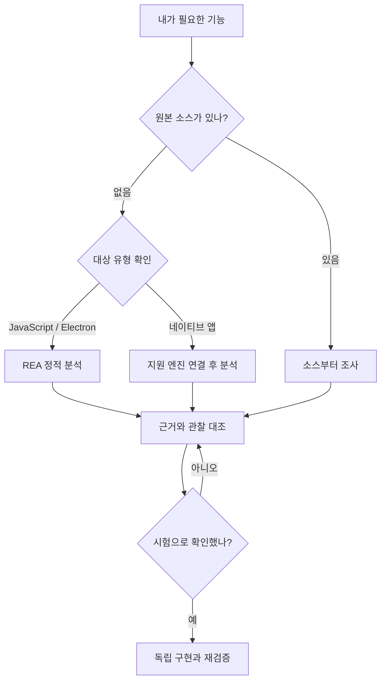

# REA 실사용 가이드

소스가 없는 앱에서 **필요한 기능 하나의 작동 원리를 조사하고, 근거를 확인한 뒤 내 프로젝트에 구현하는 방법**. 처음 읽는 사람도 따라가도록 Windows 중심으로 정리했다.

## 01 · 먼저 이해할 핵심

REA는 AI 자체나 만능 복제기가 아니다. 코딩 에이전트가 분석 도구를 사용하도록 연결하는 도구다. **AI는 질문과 구현을 담당하고, REA는 조사 경로와 근거를 전달하고, Ghidra 같은 엔진은 네이티브 바이너리를 분석한다.** JavaScript/Electron 정적 분석은 네이티브 엔진 없이 시작할 수 있다. [공식 저장소](https://github.com/morluto/rea)

레시피를 잃어버린 요리를 떠올리면 쉽다. 완성된 요리의 재료와 조리 흔적을 조사해 비슷한 결과를 만드는 것이 역공학이다. 원래 요리사의 메모까지 그대로 되찾는 것은 아니다.

### 이 가이드의 검증 범위

| 표시 | 의미 |
| --- | --- |
| 영상 설명 기준 | 사용자가 제공한 설명글·타임라인에 있는 주장. 영상 전체 재생·자막·실험 원본을 독립 검증한 것은 아님 |
| 공식 문서 확인 | 2026-10-13 한국시간에 REA 저장소·공식 가이드·법령 안내에서 확인한 내용 |
| 실무 제안 | 위 자료를 토대로 이 가이드에서 새로 설계한 작업 순서·프롬프트·평가 방식 |

유튜브 두 페이지는 이번 조회에서 오류가 발생했다. 따라서 화면에서만 보이는 명령, 첫 영상의 잘못 해석한 근거의 구체적 내용, 전체 채점표는 복원하거나 추측하지 않았다. 설치와 지원 조건은 조회 당시 공식 문서를 반영했으며, 저장소 main 문서와 실제 npm 배포판의 기능은 다를 수 있다. 이 문서를 만들면서 사용자 PC에 REA를 설치하거나 실제 앱을 역분석한 것은 아니다.

### 광고·과장 문구를 걸러낸 결론

- 강의·커뮤니티·구독·알림 홍보는 학습 본문에서 제외했다.
- “소프트웨어는 끝났다”, “몇 분이면 모든 앱 복제”는 실험으로 입증된 결론이 아니다.
- GitHub 순위·별 수·조회수는 설치 판단이나 성능 증거로 사용하지 않았다.
- 23분·6분·74점·16개 성공은 해당 영상의 특정 실험 결과다. 내 작업의 시간·비용·성공률을 보장하지 않는다.
- 보기 좋은 클론, 특정 파일 읽기 성공, 원본 내부 구조 이해는 각각 다른 성과다.

## 02 · 영상 1 — 앱을 분석하고 다시 만들기

[단테랩스 영상 열기](https://youtu.be/F0p9SX9T6As)

**질문:** 원본 소스를 보지 못하는 에이전트가 패키징된 자료 관리 앱을 얼마나 이해하고 재구현할 수 있을까?

영상 설명에 따르면 제작자는 자신이 소스를 가진 Serpent 포크를 대상으로 준비·분석·평가 역할을 나눴다. 분석 담당의 원본 소스·웹 검색·GitHub 조회를 막고 REA로 조사하도록 했으며, 평가 담당은 원본 소스와 대조했다.

| 구간 | 설명글 기준 내용 | 실무에서 가져올 점 |
| --- | --- | --- |
| [02:19](https://youtu.be/F0p9SX9T6As?t=139) | REA와 기존 분석 도구의 차이 | 에이전트·연결 도구·분석 엔진을 구분한다 |
| [05:29](https://youtu.be/F0p9SX9T6As?t=329) | 실험 앱 선정 이유 | 처음에는 직접 만든 작고 권리가 명확한 앱을 쓴다 |
| [07:17](https://youtu.be/F0p9SX9T6As?t=437) | 준비·분석·평가의 역할 분리 | 분석 담당에게 정답이 새어 들어가지 않게 한다 |
| [09:54](https://youtu.be/F0p9SX9T6As?t=594) | 분석에서 알아낸 내용 | 결론마다 파일 위치·함수·바이트 등 근거를 남긴다 |
| [13:15](https://youtu.be/F0p9SX9T6As?t=795) | 약 23분 만에 클론 생성 | 실행되는 결과와 내부 이해를 별도로 평가한다 |
| [14:37](https://youtu.be/F0p9SX9T6As?t=877) | 100점 중 74점, Evidence 24건 중 22건 일치 | 근거 일부의 오류도 설계 전체에 영향을 줄 수 있다 |
| [17:14](https://youtu.be/F0p9SX9T6As?t=1034) | 분석 구조에 약 6분 만에 기능 추가 | 이해한 부분부터 작은 확장 기능을 붙인다 |
| [18:42](https://youtu.be/F0p9SX9T6As?t=1122) | 활용 분야와 비판 | 시연 성공을 모든 앱으로 일반화하지 않는다 |
| [21:37](https://youtu.be/F0p9SX9T6As?t=1297) | 저작권·약관 | 분석 허용 범위와 재배포 권리를 따로 확인한다 |

**숫자 읽는 법:** 22/24는 약 91.7%지만, 이것은 설명글에 나온 근거 항목의 일치 비율이다. 앱 전체 정확도 91.7%라는 뜻이 아니며 74점과 같은 지표도 아니다. 전체 평가 항목·가중치·실험 파일은 이번에 확보하지 못했다. 어떤 근거를 잘못 읽었는지와 추가한 기능의 정확한 내용도 설명글만으로 확정할 수 없다.

## 03 · 영상 2 — REA가 없어도 가능할까?

[개발동생 영상 열기](https://youtu.be/rwCDPZP_Zk4)

**질문:** 같은 조건에서 REA를 붙이면 코딩 에이전트의 파일 분석 결과가 더 좋아질까?

| 비교 조건 | 영상 설명 기준 |
| --- | --- |
| 대상 | 직접 만든 macOS 노트 앱 NoteVault. C++ 파일 엔진과 AppKit 화면 |
| 과제 | 원본 앱 없이 .nvlt 파일을 읽는 Python 함수 작성 |
| 모델·시간 | 양쪽 모두 GPT-6.1 Sol, 각 10분. 모델명은 설명글 표기를 보존한 것 |
| 입력 | 같은 앱과 파일, 원본 소스 미제공 |
| 평가 | 미리 만든 정상 파일 8개·손상 파일 8개 |
| 결과 | REA 사용·미사용 양쪽 모두 16개 통과 |
| 관찰 | REA 미사용 쪽도 Ghidra를 직접 실행하여 분석 |

**핵심:** REA 미사용은 “역공학 도구 없이”라는 뜻이 아니다. 두 조건 모두 분석 엔진을 사용할 수 있었다. 따라서 이 실험은 REA만이 역공학을 가능하게 한다는 주장을 뒷받침하지 않는다. 반대로 두 조건이 같은 정확도를 냈다는 이유만으로 설치 편의·작업 반복성·근거 관리 측면까지 동등하다고 단정할 수도 없다. 비용·토큰·반복 실행 통계는 제공된 설명에서 확인되지 않았다.

### 다시 볼 구간

| 구간 | 학습 주제 |
| --- | --- |
| [00:00](https://youtu.be/rwCDPZP_Zk4?t=0) · [01:14](https://youtu.be/rwCDPZP_Zk4?t=74) | 도구 개요, 웹 화면 복제와 앱 내부 조사 차이 |
| [02:10](https://youtu.be/rwCDPZP_Zk4?t=130) · [03:08](https://youtu.be/rwCDPZP_Zk4?t=188) · [03:54](https://youtu.be/rwCDPZP_Zk4?t=234) | Steam·DX-Ball·Notion·TradingView 사례 소개 |
| [04:41](https://youtu.be/rwCDPZP_Zk4?t=281) | 설치와 분석 엔진 |
| [05:38](https://youtu.be/rwCDPZP_Zk4?t=338) · [06:30](https://youtu.be/rwCDPZP_Zk4?t=390) | NoteVault와 대조 실험 조건 |
| [07:41](https://youtu.be/rwCDPZP_Zk4?t=461) · [08:17](https://youtu.be/rwCDPZP_Zk4?t=497) | 노트 읽기와 손상 파일 평가 |
| [08:48](https://youtu.be/rwCDPZP_Zk4?t=528) · [09:38](https://youtu.be/rwCDPZP_Zk4?t=578) | 미사용 쪽의 Ghidra 활용, REA의 도움 범위 |
| [10:50](https://youtu.be/rwCDPZP_Zk4?t=650) | AI 래퍼와 제품 경쟁력에 관한 제작자 의견 |
| [12:40](https://youtu.be/rwCDPZP_Zk4?t=760) · [13:54](https://youtu.be/rwCDPZP_Zk4?t=834) · [15:15](https://youtu.be/rwCDPZP_Zk4?t=915) | 권리, 과열된 관심, 데이터·신뢰 |

외부 사례 소개는 이 영상의 NoteVault 실험과 별개다. Steam·TradingView의 성과를 독립 재현했다고 간주하지 않는다. 공식 Notion 사례 역시 특정 Electron 복사 경로의 추적이지 Notion 서버 전체 복구를 뜻하지 않는다.

### 두 영상을 함께 읽으면

| 영상 1의 교훈 | 영상 2의 교훈 | 내 작업 원칙 |
| --- | --- | --- |
| 그럴듯한 구현에도 해석 오류가 남는다 | REA 없이도 다른 도구로 성공할 수 있다 | 도구 이름보다 근거와 시험 결과를 본다 |
| 역할을 분리하면 검증이 쉬워진다 | 같은 조건의 비교가 중요하다 | 정답을 분리하고 동일 입력으로 평가한다 |
| 이해한 부분에 기능을 추가할 수 있다 | 작은 실험만으로 전체 성능을 말할 수 없다 | 기능 하나씩 좁혀 반복한다 |

## 04 · 무엇부터 적용하면 좋을까?

다음은 영상의 주장이 아닌 **이 가이드의 실무 제안**이다.

| 내 상황 | 먼저 할 일 | REA가 필요한 지점 |
| --- | --- | --- |
| 내가 만든 웹사이트의 소스가 있음 | 저장소 코드와 실행 화면을 직접 조사 | 소스만으로 풀리면 불필요 |
| 랜딩페이지의 배치·모션만 참고 | 허용된 화면 관찰과 내 디자인 구현 | 바이너리 역분석은 대개 불필요 |
| 권한 있는 Electron 앱의 CSV 내보내기 이해 | 패키지와 기능 경로 정적 분석 | REA 입문에 적합 |
| 오래된 자체 도구의 전용 파일을 변환 | 샘플 파일·읽기 함수·경계조건 조사 | 포맷 규칙과 오류 처리 검증 |
| 네이티브 앱 기능을 조사 | OS·CPU·엔진 호환성부터 확인 | Ghidra 등 추가 분석 엔진 필요 |
| 클라우드 서비스의 서버 기능을 만들고 싶음 | 요구사항·공개 API·허용된 동작 관찰 | 클라이언트 분석만으로 서버 내부 복구 불가 |

**추천 첫 과제:** 연습용 Electron 앱의 “노트 CSV 내보내기” 경로를 읽고, 한글·줄바꿈·쉼표가 있는 입력을 처리하는 내 함수로 구현한다. 이 과제는 사용자의 마케팅 자료 정리·콘텐츠 관리 도구 개발에도 연결하기 쉽다. 고객·환자 데이터 대신 가짜 자료를 사용한다.



## 05 · 설치 — Windows에서 시작하기

아래는 실행 가이드다. 이 문서를 읽는 것만으로 설치되지는 않는다. 명령은 PowerShell에, 자연어 프롬프트는 코딩 에이전트 대화창에 넣는다.

### 5-1. 준비물과 버전 확인

- 분석할 파일이 있는 PC에서 실행하는 코딩 에이전트.
- Node.js와 npm. 조회한 REA 문서는 Node 22.19 이상 22.x, 24.11 이상 24.x 또는 26 이상을 지원한다고 명시한다. 23·25·프리릴리스는 제외한다.
- 권한이 명확한 작은 테스트 앱 또는 공식 예제.
- 원본과 분리된 작업 폴더. 예시 경로는 실제 자신의 경로로 교체한다.

```powershell
# PowerShell에 입력. REA 설치 전에 현재 버전을 확인한다.
node --version
npm --version
```

### 5-2. 에이전트 연결

```powershell
# 다운로드 승인과 REA 설정 변경 승인은 서로 별개다.
npx rea-agents@latest setup
```

사용 중인 에이전트를 선택하고 표시된 변경 경로를 읽은 뒤 승인한다. 완료 메시지에서 지정한 에이전트를 다시 시작한다. JavaScript 정적 분석부터 할 때는 Hopper 설치가 필수는 아니다.

```powershell
# Codex 연결만 진단하는 예. 실제 사용하는 클라이언트에 맞춘다.
npx rea-agents@latest doctor --client codex --json

# 사용할 명령 목록 확인. 문서와 설치판의 옵션이 다를 때 기준이 된다.
npx rea-agents@latest --help
```

정상 판단은 “설치 명령이 끝남”이 아니라 **선택한 에이전트가 REA 도구를 인식하고 실제 테스트 요청을 처리함**이다. [설치 공식 문서](https://github.com/morluto/rea/blob/main/docs/installation.md)

### 5-3. 네이티브 앱만 — Ghidra 추가 준비

처음에는 이 단계를 건너뛰고 다음 장의 JavaScript 예제로 시작해도 된다. Ghidra는 [공식 배포 저장소](https://github.com/NationalSecurityAgency/ghidra/releases)에서 받는다. 조회한 REA Windows 가이드는 **실험적 Windows 10 이상 x64, 로컬 고정 NTFS, Ghidra 12.1.x, 호환되는 64비트 full JDK**를 명시하며 12.1.4로 검증했다고 설명한다. JDK에는 `javac`도 있어야 한다. Ghidra 자체의 최신 버전과 REA가 검증한 버전은 같지 않을 수 있다.

```powershell
# 아래 두 경로는 예시. 실제 압축 해제·설치 위치로 바꾼다.
$env:GHIDRA_INSTALL_DIR = "C:\tools\ghidra_12.1.4_PUBLIC"
$env:JAVA_HOME = "C:\tools\jdk-21"
$env:REA_ANALYSIS_PROVIDER = "ghidra"

# 선택한 JDK가 실행되고 컴파일러도 있는지 확인한다.
& "$env:JAVA_HOME\bin\java.exe" -version
& "$env:JAVA_HOME\bin\javac.exe" -version
npx rea-agents@latest doctor --provider ghidra --json

# 같은 PowerShell에서 설정을 갱신하고 에이전트를 다시 시작한다.
npx rea-agents@latest setup
```

위 환경변수는 현재 PowerShell 세션에 설정된다. 이미 실행 중인 GUI 에이전트에 자동 반영된다고 생각하면 안 된다. 설정 결과에서 엔진 경로가 에이전트 연결에 반영됐는지 확인한다. 32비트 대상·특수 파일 시스템 등은 설치판 지원을 별도로 판정한다. [Windows 지원 범위](https://github.com/morluto/rea/blob/main/docs/windows-ghidra-p0.md)

## 06 · 첫 실습 — 파일 내보내기 경로 읽기

REA 공식 JavaScript 가이드에는 작은 노트 앱 예제가 있다. **원본 소스가 포함된 연습 자료**이므로 블라인드 역공학 성능 시험은 아니다. 연결과 근거 읽는 법을 익히는 용도다. 정적 분석에는 Electron을 실행할 필요가 없다. [공식 예제 설명](https://rea.tools/guides/javascript/) · [예제 ZIP](https://rea.tools/examples/notes-example.zip)

1. ZIP을 풀고 실제 `notes-example` 폴더 경로를 확인한다.
2. 아래 경로를 그 위치로 바꾼다.
3. JSON이 나오면 입력 폴더·모듈·IPC 근거 위치를 확인한다.
4. 다음 장 프롬프트로 원리 설명과 재검증을 요청한다.

```powershell
# 실제 폴더로 교체한다. 실행 파일 대신 폴더를 지정하는 연습이다.
npx rea-agents@latest analyze-javascript-application "C:\REA-Lab\notes-example" --json
```

공식 예제의 관찰 경로는 화면의 `notes.exportCsv()` → preload → `notes:export` IPC → main 처리기 → CSV 작성이다. 정적 분석은 코드상 연결을 보여준다. 실제 클릭 시 실행되는지 확인하는 동적 관찰과는 다르다. 예제 안내의 기준 결과는 IPC 채널 1개와 대응 처리기 1개다. 버전이 달라지면 실제 파일과 결과 구조를 우선한다.

### 원본 보호용 작업 구분

| 폴더 | 담을 것 | 원칙 |
| --- | --- | --- |
| input | 분석 대상 복사본·시험 데이터 | 분석 중 수정하지 않는다 |
| evidence | 근거 JSON·관찰 기록 | 결론의 출처와 연결한다 |
| implementation | 내가 만드는 코드 | 원본과 분리한다 |
| tests | 입력·정답·시험 결과 | 구현을 보고 정답을 바꾸지 않는다 |
| report | 명세·검수표 | 확인·추론·미확인을 표시한다 |

이 폴더 구성은 실무 제안이며 REA가 자동 생성하는 표준 구조는 아니다.

## 07 · 순서대로 복붙하는 프롬프트 10개

**사용법:** 대괄호 값을 먼저 바꾸고 한 단계씩 입력한다. 앞 단계의 결과를 확인한 뒤 다음 단계로 간다. 전부 한꺼번에 붙여 넣지 않는다. 아래 프롬프트는 영상 원문이 아니라 이 가이드에서 만든 실무 템플릿이다.

### P01 · 환경 점검

```text
REA 분석을 준비해줘. 이번 단계는 점검만 한다.
작업 PC: [Windows/macOS/Linux 및 CPU]
분석 대상 절대 경로: [경로]
작업 폴더: [경로]
사용 에이전트: [이름]
분석 목적: [기능 하나]

OS·CPU·Node·npm·REA 버전과 MCP 연결 상태를 확인해줘.
대상이 Electron/JavaScript, 네이티브, .NET 중 무엇인지 실제 파일 근거로 구분해줘.
공식 문서와 설치판 help를 대조해서 필요한 도구만 제시해줘.
지금 단계에서 설치·설정 변경·앱 실행은 하지 마.
결과를 준비됨/부족함/확인불가로 나누고 다음에 실행할 정확한 명령을 적어줘.
```

**통과 기준:** 파일 유형, 실제 경로, 필요한 엔진이 식별됐다. “아마 Electron”만으로는 통과가 아니다.

### P02 · 권한·범위·정답 분리

```text
분석 범위를 다음으로 고정해줘.
대상: [내가 만든 앱 또는 분석 권한이 확인된 앱]
권한 근거: [자체 제작/허용 라이선스/분석 승인]
입력 폴더: [절대 경로]
출력 폴더: [절대 경로]
이번에 이해할 기능: [예: 노트 CSV 내보내기]
성공 조건: [예: 한글·쉼표·줄바꿈이 있는 노트를 정확히 내보냄]

원본을 수정하지 않고 입력 복사본으로 조사해줘.
블라인드 실험이면 원본 소스·정답 폴더·웹의 동일 소스를 분석 과정에서 읽지 마.
일반 실무 조사이면 공개 문서 사용 여부를 기록해줘.
허용 파일, 제외 파일, 실행이 필요한 작업을 표로 정리하고 분석계획.md에 저장해줘.
범위를 벗어난 변경은 먼저 설명하고 멈춰줘.
```

**통과 기준:** 입력·출력·목적·제외 범위가 구체적이다. 단순 프롬프트는 보안 격리가 아니므로 엄격한 블라인드 실험은 별도 작업 폴더와 접근 제한도 적용한다.

### P03 · 정적 구조 지도

```text
승인한 대상의 정적 구조를 REA로 조사해줘. 대상 앱은 실행하지 마.
입력: [절대 경로]
출력: [evidence 폴더]

진입점, 주요 모듈, 파일 읽기·쓰기 지점, 프로세스 경계를 정리해줘.
Electron이면 renderer/preload/main 및 IPC 연결을 조사해줘.
네이티브면 파일 형식·CPU와 문자열·심볼·함수 참조를 출발점으로 삼아줘.
도구가 실제 제공한 결과만 인용하고 존재하지 않는 도구 이름이나 주소를 만들지 마.
확인 사실/추론/미해결을 나누어 구조지도.md로 저장해줘.
각 결론에 파일·줄·함수 주소 등 재확인 가능한 근거 위치를 연결해줘.
```

**통과 기준:** 전체 덤프 대신 이번 기능에 필요한 진입점이 좁혀졌다.

### P04 · 기능 하나 끝까지 추적

```text
이번 기능만 끝까지 추적해줘: [기능명]
시작 동작 또는 입력: [버튼/메뉴/파일]
기대 출력: [파일/화면/반환값]

입력 → 변환 → 저장 또는 통신 → 반환의 실제 연결을 근거로 설명해줘.
동명 함수·중복 처리기가 있으면 각각 구분하고 연결 근거가 약한 곳은 미확인으로 남겨줘.
서버에만 있는 로직을 클라이언트 코드에서 발견한 것처럼 쓰지 마.
결론/근거 위치/반대 가능성/추가 확인 방법의 표를 만들어줘.
작동 원리를 쉬운 한국어로 먼저 설명한 뒤 기술 명세를 작성해줘.
```

**통과 기준:** 이름이 비슷해서 연결했다는 추측이 아니라 호출·참조 근거가 있다.

### P05 · 틀렸을 가능성부터 검증

```text
앞선 분석을 반박하는 검수 역할로 바꿔줘.
핵심 결론마다 독립적인 두 번째 근거 또는 재현 시험을 찾아줘.
의사코드 하나만으로 확정한 내용은 명령어·원시 데이터·호출자·입출력 중 다른 근거와 대조해줘.
확인된 오류가 있으면 그 오류에 의존한 결론과 설계까지 다시 점검해줘.
실행 관찰이 필요하면 어떤 앱을 어떤 입력으로 실행하며 어떤 파일·네트워크 부작용이 있는지 먼저 제시해줘.
실행 승인이 없으면 정적 검수까지만 진행해줘.
최종 상태는 확인/유력한 추론/미확인/반증으로 표시해줘.
```

**통과 기준:** 중요한 미확인 사항이 숨겨지지 않았고, 틀린 근거의 영향 범위가 정리됐다.

### P06 · 독립 구현용 명세

```text
검증된 동작만으로 새 구현 명세를 작성해줘. 아직 코드는 작성하지 마.
목표: [내 프로젝트에서 필요한 기능]
기술 환경: [예: Python / HTML·CSS·JavaScript / 기존 프로젝트]

입력 형식, 출력 형식, 한글 처리, 빈 값, 길이 제한, 오류 처리, 저장 위치를 명시해줘.
원본 고유 로고·문구·이미지·소스 표현을 복사하는 지시를 넣지 마.
확인되지 않은 암호화·압축·체크섬 규칙을 추정 사실로 넣지 마.
각 요구사항에 근거 ID와 검증 방법을 연결해줘.
미확인 부분을 포함하지 않는 최소 기능과 향후 확장으로 나눠줘.
```

**통과 기준:** 구현 담당이 분석 원문 없이도 입력·출력·시험 기준을 이해할 수 있다. 명세 분리만으로 모든 권리 문제가 해결되는 것은 아니다.

### P07 · 최소 기능 구현

```text
확정한 명세를 구현해줘.
명세 경로: [경로]
작업 경로: [implementation 폴더]
사용 기술: [기술]

이번에는 [기능 하나]만 구현하고 원본 앱과 입력 파일을 수정하지 마.
의존성은 필요한 것만 추가하고 실행 명령과 예시 입력을 README에 적어줘.
오류 상황을 정상 결과로 숨기지 말고 사용자가 구분할 수 있게 반환해줘.
미확인 동작은 구현 완료로 표시하지 마.
실제 실행한 검증, 실행하지 못한 검증, 남은 제약을 구분해서 보고해줘.
```

**통과 기준:** 내가 실행할 명령·예시·실패 처리까지 갖춰졌다.

### P08 · 독립 시험과 점수표

```text
평가 담당으로서 구현을 검수해줘.
명세: [경로]
구현: [경로]
고정한 시험 입력과 정답: [tests 경로]

구현 결과에 맞춰 정답을 바꾸지 마.
정상 입력뿐 아니라 빈 값·한글·줄바꿈·손상·잘린 파일·경계값 등 명세에 맞는 항목을 시험해줘.
동작 일치, 오류 처리, 데이터 무결성, 근거 신뢰성을 별도로 보고해줘.
실행한 시험 수/통과/실패/미실행과 실패 입력을 기록해줘.
미실행은 성공으로 계산하지 마. 부분 성공을 전체 앱 복제로 표현하지 마.
```

**통과 기준:** 실제 실행 결과가 있으며, 미실행 항목이 분리되어 있다.

### P09 · 내 업무 기능 하나 추가

```text
검증이 끝난 구현에 기능 하나를 추가해줘.
추가 기능: [예: 제목·태그·원본 링크를 포함한 Markdown 내보내기]
기존 동작 중 반드시 유지할 것: [목록]
완료 조건: [측정 가능한 조건]

먼저 영향을 받는 모듈과 데이터 형식을 짚어줘.
원본 자산을 복사하지 않고 내 프로젝트 방식으로 구현해줘.
기존 시험과 신규 시험을 실행하여 회귀 여부를 확인해줘.
변경 파일, 실행 방법, 확인된 결과, 남은 제약을 정리해줘.
```

**통과 기준:** 신규 기능뿐 아니라 기존 기능도 계속 작동한다.

### P10 · 실패할 때 진단

```text
REA 작업 실패를 진단해줘. 무작정 재설치하지 마.
실행한 명령: [명령]
오류 전문: [토큰·개인정보를 제거한 로그]
대상 유형과 경로: [정보]
OS·CPU·Node·REA·분석 엔진 버전: [확인값]

MCP 연결 문제, 엔진 준비 문제, 대상 미지원, 경로·권한 문제, 분석 시간 초과를 구분해줘.
선택한 client/provider에 한정한 doctor 결과와 설치판 help를 확인해줘.
읽기 전용 점검부터 수행하고 가장 작은 수정안을 제시해줘.
수정 후 동일 입력으로 다시 확인하며, 보안 설정이나 승인 절차를 임의로 해제하지 마.
```

## 08 · 검수표 — 믿어도 되는 결과인지 보기

### Evidence 기록 양식

| ID | 결론 | 근거 위치 | 상태 | 독립 확인 | 구현 영향 |
| --- | --- | --- | --- | --- | --- |
| E01 | [결론] | [파일·줄·주소] | 확인/추론/미확인/반증 | [관찰 또는 시험] | [영향 기능] |

예를 들어 함수 이름에 `encrypt`가 있다고 해서 실제로 안전한 암호화를 사용한다고 확정하면 안 된다. 함수 본문·호출 경로·입출력의 대응이 필요하다. 문자열이 있다는 것과 그 코드가 실행된다는 것도 다르다.

### 점수보다 먼저 볼 체크리스트

- 분석 대상 파일·버전·해시가 기록됐는가?
- 원본 소스와 정답이 분석 담당에게 유출되지 않았는가? 블라인드 실험일 때 확인한다.
- 중요한 결론마다 실제 근거 위치가 있는가?
- 입력과 출력을 같은 기준으로 비교했는가?
- 빈 값·한글·큰 입력·손상 입력 등 관련 경계조건을 시험했는가?
- 오류를 정상 데이터로 처리하지 않는가?
- 분석하지 못한 기능이 목록으로 남아 있는가?
- 실행 시간과 비용을 측정했다면 그 측정 범위를 명시했는가?

### 선택형 100점 평가안

아래 배점은 **이 가이드의 제안**이며 영상 1의 원래 채점표가 아니다.

| 영역 | 배점 | 기준 |
| --- | --- | --- |
| 핵심 동작 | 40 | 미리 정한 정상 사례와 동작 일치 |
| 오류·경계조건 | 25 | 손상·빈 값·한계 상황을 명세대로 처리 |
| 근거 품질 | 20 | 위치 추적 가능, 추론 분리, 반증 검토 |
| 재현 가능성 | 15 | 버전·입력·실행 명령·시험 결과 제공 |

심각한 데이터 손실이나 권한 범위 위반은 높은 합계 점수로 상쇄하지 않는다. “데모 가능”과 “실서비스 투입 가능”은 별도 판단한다.

## 09 · 용어 사전 — 읽는 법과 쉬운 뜻

| 용어·읽는 법 | 쉬운 뜻 | 이번 작업에서의 역할 |
| --- | --- | --- |
| REA · 알이 에이 | Reverse Engineer Anything | 에이전트가 분석 도구를 쓰도록 연결 |
| Reverse engineering · 리버스 엔지니어링 | 완성된 결과에서 원리를 거꾸로 조사 | 소스 없는 기능을 이해 |
| Agent · 에이전트 | 도구를 써서 여러 작업을 수행하는 AI 시스템 | 조사·구현·검증 진행 |
| MCP · 엠씨피 | AI 앱과 외부 도구가 대화하는 연결 규약 | REA 도구 호출 |
| CLI · 씨엘아이 | 터미널에 글자로 명령하는 방식 | npx 명령 실행 |
| Skill · 스킬 | 에이전트용 절차·지침 묶음 | 어떤 순서로 조사할지 안내 |
| Node.js · 노드 제이에스 | JavaScript 실행 환경 | REA 실행 기반 |
| npm · 엔피엠 | Node 패키지 관리 도구 | 패키지 설치·조회 |
| npx · 엔피엑스 | 패키지 명령 실행 도구 | REA 실행. 필요하면 다운로드함 |
| Provider · 프로바이더 | 실제 분석을 수행하는 엔진 제공자 | Ghidra·Hopper·IDA 선택 |
| Ghidra · 기드라 | 역공학 분석 도구 | 네이티브 코드 구조 조사 |
| Binary · 바이너리 | 컴퓨터용 이진 형식 파일 | .exe 등 분석 대상 |
| Native · 네이티브 | 특정 OS·CPU용으로 빌드된 프로그램 | 별도 분석 엔진이 필요할 수 있음 |
| Electron · 일렉트론 | 웹 기술로 데스크톱 앱을 만드는 기반 | JavaScript와 네이티브 부분이 섞일 수 있음 |
| ASAR · 에이사 | Electron 파일을 묶은 아카이브 | 일반적으로 암호화와 같은 뜻은 아님 |
| Renderer · 렌더러 | 화면을 담당하는 프로세스 | 버튼·화면 동작의 출발점 |
| Preload · 프리로드 | 화면에 제한된 API를 연결하는 스크립트 | renderer와 main 사이 연결 |
| Main process · 메인 프로세스 | 앱의 주요 시스템 작업 담당 | 파일 저장·창 관리 등 |
| IPC · 아이피씨 | 프로세스 사이의 메시지 통신 | 화면 요청을 파일 처리로 전달 |
| Static analysis · 정적 분석 | 앱을 실행하지 않고 파일을 조사 | 첫 조사에 사용 |
| Dynamic analysis · 동적 분석 | 실행 중 동작을 관찰 | 실제 실행 경로 확인 |
| Decompile · 디컴파일 | 기계용 코드에서 읽기 쉬운 코드를 추정 | 원래 소스를 그대로 복구하는 것은 아님 |
| Pseudocode · 슈도코드 | 로직을 보여주는 의사코드 | 오류·누락 가능성을 고려해 읽음 |
| Assembly · 어셈블리 | CPU 명령을 사람이 읽을 수 있게 표시 | 의사코드와 교차 검증 |
| Symbol · 심볼 | 함수·변수 등의 이름 정보 | 분석 단서. 제거됐을 수도 있음 |
| Xref · 엑스레프 | 다른 위치가 참조하는 관계 | 누가 함수·데이터를 쓰는지 조사 |
| Evidence · 에비던스 | 결론의 근거와 관련 기록 | 사실과 추론을 구분 |
| Hash · 해시 | 파일 내용의 지문 같은 값 | 동일한 대상인지 확인 |
| Parser · 파서 | 파일·문장을 규칙대로 읽는 코드 | .nvlt 등 형식 해석 |
| Fixture · 픽스처 | 미리 정한 시험 입력 자료 | 반복 평가에 같은 데이터 사용 |
| Regression · 리그레션 | 수정 뒤 기존 기능이 망가지는 현상 | 기능 추가 후 재검증 |
| Interoperability · 인터오퍼러빌리티 | 프로그램 간 호환·상호운용 | 전용 파일을 다른 프로그램에서 읽기 |
| MIT license · 엠아이티 라이선스 | 조건을 지키면 폭넓게 이용 가능한 라이선스 | REA 자체와 대상 앱의 권리는 별개 |
| Clean-room · 클린룸 | 분석 명세와 구현을 분리하는 접근 | 권리 보장을 자동으로 주는 면책 수단은 아님 |

## 10 · 오류가 났을 때

| 증상 | 먼저 확인할 것 | 다음 행동 |
| --- | --- | --- |
| node/npx 명령을 못 찾음 | 설치 여부·PATH·터미널 재시작 | Node와 npm이 보이는 터미널에서 버전 재확인 |
| 에이전트에 REA가 안 보임 | 선택한 client·설정 경로·재시작 여부 | 해당 client만 doctor로 진단 |
| 분석 엔진이 없다고 나옴 | 대상이 실제 네이티브인지 | JavaScript면 정적 경로, 네이티브면 엔진 준비 |
| Ghidra가 실행되지 않음 | 설치 폴더·full JDK·CPU·지원판 | provider 진단에서 실패한 항목만 수정 |
| 여러 provider 때문에 선택 불가 | 실제 가용 엔진 목록 | 지원되는 엔진을 명시적으로 선택 |
| Windows 네이티브 분석 실패 | x64 호스트·NTFS·대상 형식·npm 판 | 실험적 지원 범위와 대조 |
| 분석이 오래 걸림 | 대상 크기·엔진 초기 분석·클라이언트 제한 | 작업 범위를 줄이고 실제 timeout 원인 확인 |
| JSON이 너무 큼 | 전체 결과를 대화에 넣었는지 | 파일로 보관하고 필요한 모듈·요약만 읽기 |
| 그럴듯한 설명인데 근거가 없음 | 코드 위치·호출 관계·시험 기록 | P05로 반증 검수, 미확인은 그대로 표시 |

CLI는 호출마다 별도 프로세스이므로 큰 앱을 여러 번 전체 분석하면 낭비가 생길 수 있다. 결과 파일·지원되는 분석 뷰·세션을 활용하되, 설치판 기능을 먼저 확인한다. [CLI·Evidence 공식 문서](https://github.com/morluto/rea/blob/main/docs/cli.md)

## 11 · 저작권·약관·데이터에서 꼭 구분할 것

**REA의 MIT 라이선스는 분석 대상 앱의 코드·이미지·상표까지 사용할 권리를 주지 않는다.** 자체 제작 앱 또는 명확하게 허용된 대상부터 실습한다.

공식 생활법령 안내는 제101조의3의 조사·연구·시험을 위한 복제와 제101조의4의 호환 목적 코드 역분석을 구분한다. 제101조의4는 정당한 이용 권한, 호환 정보 획득의 필요성, 필요한 범위 제한을 전제로 하며, 얻은 정보의 다른 목적 사용이나 실질적으로 유사한 표현의 프로그램 제작 등에 제한이 있다. “구매했으니 아무렇게나 복제·배포 가능”이라는 해석은 맞지 않는다. [공식 안내](https://www.easylaw.go.kr/CSP/CnpClsMain.laf?ccfNo=3&cciNo=2&cnpClsNo=8&csmSeq=695)

해당 안내 페이지에는 2026-10-29 시행 예정 개정 관련 고지가 있다. 이 문서는 2026-10-13에 작성됐으므로 예정된 개정을 이미 시행 중인 규정처럼 설명하지 않는다. 구체적인 상용 앱 적용은 대상의 이용약관과 적용 시점의 법 조문을 함께 검토해야 한다.

- 프로그램 이용 권한, 코드 분석 허용 범위, 결과물 배포 권한은 따로 기록한다.
- 상표·로고·유료 이미지·문구·자산은 별도 권리 대상일 수 있다.
- 라이선스 인증·결제·접근통제 해제를 이 실습 과제에 섞지 않는다.
- REA 분석이 로컬에서 이루어져도 에이전트가 받는 결과는 사용하는 모델 서비스에 전달될 수 있다. 로컬 분석과 데이터 외부 전송 없음은 같은 뜻이 아니다. [REA FAQ](https://github.com/morluto/rea#faq)
- 고객 정보·환자 자료·로그인 쿠키·토큰 대신 합성 데이터와 테스트 계정을 사용한다.

## 12 · 출퇴근 학습 순서와 출처

### 세 번 나눠 공부하기

| 순서 | 읽을 내용 | 이해했는지 스스로 확인 |
| --- | --- | --- |
| 첫 번째 | 01~04장 | REA와 Ghidra 차이를 내 말로 설명할 수 있나? |
| 두 번째 | 05~07장 P01~P05 | 내 대상 유형·환경·근거를 구분할 수 있나? |
| 세 번째 | 07장 P06~P10, 08~11장 | 구현 결과를 독립적으로 검증할 수 있나? |

실제 PC 앞에서는 **환경 점검 → 공식 작은 예제 → 기능 하나 추적 → 검수 → 독립 구현** 순서로 진행한다. 처음부터 앱 전체 복제를 목표로 삼지 않는다.

### 출처 목록

| 자료 | 사용한 범위 | 확인 상태 |
| --- | --- | --- |
| [영상 1](https://youtu.be/F0p9SX9T6As) | 실험 설계·수치·타임라인 | 사용자 제공 설명 기준 |
| [영상 2](https://youtu.be/rwCDPZP_Zk4) | NoteVault 비교 실험·수치·타임라인 | 사용자 제공 설명 기준 |
| [REA 저장소](https://github.com/morluto/rea) | 도구 역할·지원 대상·데이터 처리·라이선스 | 공식 문서 확인 |
| [REA 한국어 README](https://github.com/morluto/rea/blob/main/README_ko.md) | 한국어 추가 학습 링크 | 별도 번역본 정합성 검수는 하지 않음 |
| [설치 문서](https://github.com/morluto/rea/blob/main/docs/installation.md) | setup·doctor·Node 조건 | 공식 문서 확인 |
| [Windows Ghidra](https://github.com/morluto/rea/blob/main/docs/windows-ghidra-p0.md) | 실험적 Windows 지원 조건 | main 문서 확인, 배포판 차이 주의 |
| [JavaScript 예제](https://rea.tools/guides/javascript/) | 노트 CSV·IPC 실습 | 공식 문서 확인 |
| [네이티브 분석 예제](https://rea.tools/guides/native/) | 의사코드·명령어·호출·바이트 교차 확인 | 공식 문서 확인 |
| [CLI·Evidence](https://github.com/morluto/rea/blob/main/docs/cli.md) | 명령·결과 보관·분석 범위 | 공식 문서 확인 |
| [Ghidra 공식 저장소](https://github.com/NationalSecurityAgency/ghidra) | 분석 엔진 공식 배포 경로 | 공식 저장소 확인 |
| [생활법령정보](https://www.easylaw.go.kr/CSP/CnpClsMain.laf?ccfNo=3&cciNo=2&cnpClsNo=8&csmSeq=695) | 제101조의3·제101조의4 요건 | 공식 안내 확인 |
| [단테랩스](https://dante-labs.com/) | 영상 게시 확인 | 홈페이지 확인, 설명글의 생략된 실험 자료 URL은 미확보 |

이 가이드는 두 영상의 설명을 요약하고 공식 자료를 보충한 학습 문서다. 실제 실험을 재현해 얻은 성능 보고서가 아니다.
