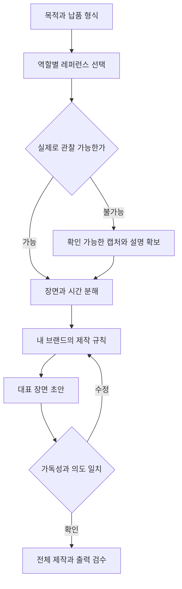

# 영상 레퍼런스를 AI 제작 프롬프트로 바꾸는 실무가이드

> [!abstract] 이 문서로 할 수 있는 일
> 마음에 드는 영상을 **구도·타이포·움직임·전환·리듬으로 분해**하고, 내 브랜드용 제작 지시문으로 바꾼다. 레퍼런스 사이트 선택, 조사표, 15초 기획 예시, 복붙 프롬프트 10개, 결과물 검수까지 담았다.

## 1. 원문에서 확인한 내용과 보강 범위

작성자 `@naminsoo__ai`의 게시물은 추상적으로 예쁘게 만들어 달라고 하는 것보다, 좋은 사례를 보여주며 방향을 전달하는 방식을 제안한다. [원문 링크](https://www.threads.com/share/BAVydR4kDr/)

| 구분 | 확인 결과 |
|---|---|
| 직접 확인 | 게시물 본문, 작성자, 레퍼런스를 보여주는 접근법 |
| 확인하지 못한 부분 | 로그인 안내 이후 가려진 후속 댓글과 작성자의 구체적인 사이트 목록 |
| 별도 리서치 | 아래 4개 사이트의 실제 페이지와 제공 내용 |
| 직접 설계한 보강 자료 | 분석 체계, 시간표, 예시 수치, 프롬프트, 검수 기준 |

게시물 제목의 ‘10배’는 검증된 성능 수치로 채택하지 않는다. 제목에 나온 모델명도 이 문서의 필수 사양이나 공식 제공 확인으로 취급하지 않는다. **지금 사용하는 AI가 이미지·영상·웹페이지 중 어떤 입력을 실제로 읽는지** 먼저 확인하는 방식으로 설명한다.

## 2. 무엇을 만들지 먼저 정한다

레퍼런스를 찾기 전에 아래 다섯 줄을 채운다. 목적 없이 모으면 색감만 비슷한 자료가 쌓이고 제작 지시가 흐려진다.

```text
만들 결과물: 15초 세로 브랜드 소개 영상
보여줄 핵심: 공간의 분위기와 브랜드 이름
대상: 모바일로 보는 20~30대
사용 가능한 자료: 승인된 공간 사진 3장, 로고, 확정 문구
납품: 1080×1920 MP4 + 수정 가능한 원본 + 표지 이미지
```

위 수치와 대상은 연습용 설정이다. 플랫폼의 공식 규격이나 성과 보장값이 아니다.

### 결과물에 따라 레퍼런스의 역할이 달라진다

| 제작하려는 것 | 먼저 볼 요소 | 자료 준비 |
|---|---|---|
| 키네틱 타이포 영상 | 등장 순서, 정지 시간, 글자 간격 | 시작·중간·종료 화면과 타임코드 |
| 인물·공간 중심 AI 영상 | 카메라 경로, 피사체 움직임, 조명 | 대표 장면과 움직임 설명 |
| 웹 인트로 | 스크롤 반응, 반복 재생, 모바일 축소 | 화면 녹화와 반응 조건 |
| 브랜드 쇼릴 | 컷 배열, 완급, 음악과 전환 | 구간별 역할과 전환 시점 |
| 제품 또는 오브젝트 3D | 표면 재질, 광원, 회전축, 접지 | 최소 두 방향의 장면 또는 간단한 도식 |

영상 파일이 필요하면 처음부터 MP4 출력을 명시한다. 웹에서 움직이는 HTML을 받았다는 이유만으로 영상 납품이 끝난 것은 아니다.

## 3. 리서치 사이트 4곳과 실제 쓰는 방법

**아래 목록은 원문 작성자의 목록을 복원한 것이 아니라, 이번 작업에서 별도로 조사한 자료다.** 서비스 가격·무료 한도는 확인 범위에 포함하지 않았다.

| 사이트 | 공식 페이지에서 확인한 것 | 이번 작업에서 제안하는 활용 |
|---|---|---|
| [Eyecandy](https://eyecannndy.com/) | 영상 시각 기법별 분류와 제작 분석 자료 | 카메라·전환·타이포 동작을 이름으로 찾기 |
| [Motionographer](https://motionographer.com/) | 모션디자인 작품·제작자 이야기·제작 과정 콘텐츠 | 작품 전체의 기획과 제작 결정을 조사하기 |
| [Art of the Title](https://www.artofthetitle.com/) | 타이틀 시퀀스와 디자이너·스튜디오 자료 | 제목이 등장하는 순서와 타이포의 호흡 관찰 |
| [Cosmos](https://www.cosmos.so/) | 컬렉션, 색상 검색, 유사 이미지, 협업 기능 | 프로젝트별 색감·재질·구도 무드보드 정리 |

### Eyecandy에서 시작하는 짧은 조사

1. [Typography](https://eyecannndy.com/technique/typography)에서 문자 중심 장면을 찾는다.
2. [Match Cut](https://eyecannndy.com/technique/match-cut)에서 앞뒤 장면의 모양이나 배치가 어떻게 이어지는지 관찰한다.
3. 마음에 드는 작품 하나마다 **가져올 원리 한 가지**를 적는다.
4. 작품 제목·제작자·원문 링크를 함께 남긴다.

사이트에 GIF 저장 기능이 있더라도, 저장 가능 여부와 광고에 재사용할 권리는 구분해 기록한다. 원본 영상·음악·로고 대신 직접 만든 자산에 관찰한 원리를 적용하는 방식으로 작업한다.

### 검색어를 구체적으로 바꾸기

아래는 사이트가 보장하는 필터명이 아니라 리서치용 검색어다.

| 막연한 검색 | 구체화한 검색어 | 관찰할 것 |
|---|---|---|
| 예쁜 글자 영상 | kinetic typography editorial title sequence | 글자 등장 단위와 읽는 시간 |
| 고급스러운 영상 | minimal brand film soft light slow camera | 느린 동작 속에서도 변하는 요소 |
| 신나는 쇼릴 | motion design showreel rhythmic transitions | 음악의 강조와 화면 변화의 관계 |
| 입체 글자 | inflated 3D typography soft material | 두께·반사·그림자·변형 |
| 부드러운 장면 전환 | shape match cut motion transition | 연결하는 모양과 중심 위치 |

## 4. 레퍼런스 수집을 제작 규칙으로 바꾸기

처음에는 참고 자료 3개를 역할별로 고르는 방식을 제안한다. ‘3개’는 작업 집중을 위한 가이드값이다.

| 역할 | 가져올 요소 | 가져오지 않을 요소 |
|---|---|---|
| A: 타이포 | 제목 등장 순서, 크기 대비 | 문구·로고 그대로 |
| B: 움직임 | 이동 방향, 가감속, 정지 구간 | 모든 효과의 동시 사용 |
| C: 분위기 | 색의 관계, 재질, 광원 방향 | 원본 인물·작품 그대로 |



### 분석표 — 한 장면에 한 줄

| 항목 | 적는 내용 | 연습 예시 |
|---|---|---|
| 위치 | 화면 비율로 설명 | 제목 중심 x=50%, y=42% |
| 시간 | 시작·끝·정지 구간 | 0.0~0.5초 등장, 0.5~1.8초 정지 |
| 크기 | 화면과의 상대 크기 | 제목 가로폭 약 70% |
| 동작 | 출발·도착·변화량 | 아래 40px에서 제자리로 이동 |
| 속도 | 빠른 구간과 느린 구간 | 처음 빠르고 마지막에 감속 |
| 전환 | 장면 A와 B의 연결점 | 중앙의 원형이 다음 컷의 원형으로 연결 |
| 소리 | 소리와 동작의 관계 | 제목이 멈추는 순간 짧은 효과음 |
| 확실성 | 측정·추정 구분 | 캡처 추정값, 실측 아님 |

**한 장의 이미지로 움직임·FPS·음악·이징을 확정할 수 없다.** 정지 이미지에는 구도·색·크기 정보만 적고 시간 정보는 미확인으로 둔다. 영상 구간을 관찰했다면 타임코드를 남긴다.

### AI에 넘기는 자료 꾸러미

- 원본 URL과 제작자.
- 참고할 구간 및 그 구간을 고른 이유.
- 직접 확보한 시작·중간·끝 캡처 또는 허용된 영상 파일.
- 바꿀 내용과 유지할 요소.
- 화면비·길이·텍스트 원문·색상·납품 형식.

URL만 붙였는데 AI가 영상을 재생할 수 없다면 분석 완료라고 쓰게 두지 않는다. 관찰한 자료의 범위를 명시하고, 미확인 부분은 제작 제안으로 따로 받는다.

## 5. 제작 지시문 기본 구조

**목적 → 입력 → 참고 범위 → 고정 요소 → 움직임 → 출력 → 검수** 순서로 작성한다.

```text
목적: [누구에게 무엇을 전달할 것인가]
입력: [영상/이미지/문구/로고 파일]
참고: [A의 타이포, B의 이동 리듬, C의 색 관계]
고정: [배경, 문구, 인물 정체성, 로고 비율 등]
움직임: [무엇이 어디서 어디로, 언제, 얼마나 움직이는가]
출력: [길이, 화면비, 해상도, 파일 형식, 수정 가능한 원본]
검수: [오탈자, 잘림, 깜빡임, 검은 프레임, 음원 사용 범위]
확인하지 못한 자료는 분석한 척하지 말고 미확인으로 구분한다.
```

‘감각적·고급·역동적’만 쓰면 선택 범위가 너무 넓다. 다음처럼 바꾼다.

| 추상 표현 | 제작 가능한 표현 예시 |
|---|---|
| 고급스럽게 | 주색 2개, 강조색 1개. 제목 외 장식 축소. 넓은 여백과 긴 정지 구간 |
| 경쾌하게 | 짧은 등장과 명확한 정지. 핵심 단어가 바뀔 때만 화면 전환 |
| 입체감 있게 | 광원 방향을 고정하고 접지 그림자·앞뒤 겹침을 유지 |
| AI 티 덜 나게 | 임의 문구 추가 금지. 글자와 배경의 반복 변형을 제한하고 결과를 직접 검수 |

## 6. 바로 복붙하는 프롬프트 10개

아래는 이번 가이드에서 작성한 예시다. 원문 게시자의 프롬프트가 아니다. 대괄호만 바꾸면 사용할 수 있다.

### 01. 레퍼런스 후보 조사

```text
너는 모션디자인 리서처다.
목적: [15초 브랜드 소개 영상]
참고할 사이트: Eyecandy, Motionographer, Art of the Title, Cosmos.
사용 가능한 자료: [공간 사진, 로고, 확정 문구]

관련 후보를 최대 6개 조사하고 3개를 선정해라.
각 후보에 작품명, 제작자, 실제 열린 URL, 확인 가능한 자료 형식,
참고할 요소 1개, 내 프로젝트에 적용할 방법을 적어라.
접근하지 못한 영상의 움직임을 추정해 관찰 사실처럼 쓰지 마라.
최종 3개는 타이포·움직임·분위기의 역할을 나눠라.
원본을 재사용해야 하는 제안과 직접 새로 제작하는 제안을 구분해라.
```

### 02. 장면별 분석

```text
첨부 자료의 [00:00~00:08] 구간을 분석해라.
먼저 실제로 확인한 입력이 영상인지, 정지 이미지인지, 설명문인지 밝혀라.
영상이면 장면별로 시작/종료, 구도, 텍스트, 이동 방향, 속도 변화,
전환 연결점, 소리와의 관계를 표로 정리해라.
이미지만 확인했다면 시간·이징·음악을 임의로 만들지 마라.
측정값과 눈으로 추정한 값은 별도 표시해라.
마지막에 내 작업에 재사용할 수 있는 원리 5개를 쉬운 한글로 설명해라.
```

### 03. 서로 다른 레퍼런스 통합

```text
레퍼런스 A는 타이포, B는 움직임, C는 색 관계만 참고한다.
A: [자료]
B: [자료]
C: [자료]
내 브랜드: [이름과 성격]

세 자료를 하나의 일관된 디자인 규칙으로 정리해라.
서로 충돌하는 요소를 먼저 지적하고 각 항목에서 하나를 선택해라.
결과: 색상, 글자 계층, 여백, 재질, 광원, 등장 방식, 전환 방식,
카메라 움직임, 반복 사용 횟수, 사용하지 않을 요소.
원본의 로고·문구·캐릭터는 새 결과물에 복제하지 않는다.
```

### 04. 뷰티블라썸 브랜드 소개 15초 기획

```text
뷰티블라썸의원의 브랜드 소개 영상을 기획해라.
입력: 승인된 공간 사진 3장, 로고, 확정 문구 파일.
길이 15초, 9:16, 1080×1920, 30fps를 이번 프로젝트 사양으로 사용한다.
라이트 스카이블루와 흰색, 넓은 여백, 읽기 쉬운 한글 타이포를 사용한다.
설명 문구는 제공된 문장만 쓰고 효과 보장·최상급·전문의 자격 표현을 새로 만들지 마라.

0~3초 도입, 3~7초 공간, 7~11초 브랜드 분위기, 11~15초 이름과 안내로 구성해라.
각 구간의 화면, 문구, 움직임, 전환, 필요한 자산을 표로 작성해라.
각 문구가 멈춰서 읽히는 구간을 포함하고 동시에 움직이는 주요 요소는 제한해라.
먼저 스토리보드와 대표 정지 화면 3개를 제안해라.
```

### 05. 코딩 에이전트에 구현 요청

```text
첨부 브리프와 레퍼런스 분석표를 기준으로 모션그래픽을 구현해라.
현재 프로젝트의 파일·실행 명령·사용 가능한 렌더링 도구부터 확인해라.
산출물은 [15초 MP4]와 수정 가능한 원본이다.
웹 미리보기만 가능한 환경이면 그 사실과 영상 출력 경로를 먼저 구분해라.

전체 화면을 한 번에 만들기 전에 3초 대표 장면을 구현해라.
문구·폰트·색·장면 시간을 쉽게 수정할 수 있도록 설정값을 한곳에 모아라.
동일한 시간에는 동일한 장면이 나오도록 애니메이션을 구성해라.
대표 구간의 시작·중간·끝 화면을 확인하고 오탈자·잘림을 수정해라.
최종 보고에는 생성 파일, 실제 렌더 여부, 검수한 구간, 남은 문제를 적어라.
```

### 06. 이미지에서 영상으로 — 배경과 타이포 고정

```text
첨부 이미지 @IMG1을 기준으로 5초 장면을 만든다.
배경, 타이포 위치, 문구, 색, 로고 비율을 유지한다.
모델의 얼굴 정체성과 의상도 유지한다.
모델 동작만 조절한다: [정면에서 시선을 살짝 옆으로 이동하고 자연스럽게 미소 짓기].
카메라는 고정하고 새로운 물체·문자·액세서리를 추가하지 않는다.
시작과 끝에서 얼굴·손·문구가 깨지지 않도록 한다.
사용 도구가 배경·타이포 고정을 보장하지 못하면,
모델 영상과 원본 배경·텍스트를 분리 합성하는 대안을 제시해라.
```

### 07. 한글 타이포 움직임만 교정

```text
현재 결과물의 [2.0~4.5초] 한글 제목 등장만 수정해라.
문구: [확정 문구]
글자 윤곽을 변형하지 말고 하나의 텍스트 레이어로 처리해라.
아래에서 제자리까지 짧게 이동한 뒤 정지하고, 읽는 시간을 확보해라.
배경·색상·카메라·다른 장면의 시간은 그대로 둔다.
자소 분리, 오탈자, 획 두께 변화, 마스크 잘림이 있는지 확인해라.
수정 전후 같은 타임코드의 화면을 비교해서 보고해라.
```

### 08. 피드백을 구체적 수정 지시로 변환

```text
내 피드백을 실행 가능한 수정표로 바꿔라.
피드백: [너무 산만하고 글자가 잘 안 읽힌다]
현재 결과물: [파일]

타임코드 / 관찰한 문제 / 가능한 원인 / 바꿀 항목 / 유지할 항목 /
수정 완료 조건으로 정리해라.
관찰하지 못한 문제는 추정으로 표시해라.
한 번에 모든 스타일을 바꾸지 말고 우선순위 3개부터 제안해라.
오탈자와 가독성을 장식 효과보다 먼저 처리해라.
```

### 09. 9:16 영상을 1:1로 재배치

```text
승인된 9:16 영상을 1080×1080 버전으로 재구성해라.
단순 중앙 크롭으로 끝내지 말고 텍스트와 피사체 위치를 재배치한다.
문구, 색상, 장면 순서, 전체 길이는 유지한다.
비율 변경으로 화면 밖에 나가는 요소와 충돌하는 텍스트를 먼저 표로 찾아라.
각 장면의 대표 화면을 확인하고, 실제 게시 화면의 UI가 덮는 부분도 검토한다.
검증하지 않은 플랫폼 안전영역 수치를 공식 규격처럼 쓰지 마라.
```

### 10. 다음 프로젝트에 재사용할 규칙 정리

```text
이번 프로젝트의 최종 결과와 수정 이력을 분석해
다음 영상에 재사용할 한글 제작 가이드를 Markdown으로 작성해라.
포함: 목표, 채택한 레퍼런스 원리, 자산 목록, 디자인 규칙,
장면 시간, 잘된 지시문, 실패한 지시문, 수정 이유, 출력 명령과 검수 방법.
실제 성공한 설정과 아직 시험하지 않은 제안을 구분해라.
고유 문구와 사진은 변수로 바꾸고, 원본 출처와 사용 조건을 남겨라.
```

## 7. 15초 영상의 구체적인 제작 예시

다음은 직접 설계한 연습안이다. 실제 브랜드의 확정 광고나 영상 제작 완료 결과가 아니다.

| 시간 | 역할 | 화면 | 동작 | 확인 |
|---|---|---|---|---|
| 0~3초 | 시선 집중 | 승인된 짧은 제목 | 제목 등장 후 정지 | 제목을 끝까지 읽을 수 있는가 |
| 3~7초 | 분위기 | 공간 사진 1~2장 | 느린 이동 또는 확대 | 사진 왜곡·불필요한 새 사물 없는가 |
| 7~11초 | 인상 형성 | 브랜드 색과 간단한 도형 | 앞 장면의 모양과 연결 | 효과가 정보를 가리지 않는가 |
| 11~15초 | 이름 기억 | 로고와 확정 안내문 | 안정된 정지로 마무리 | 이름·안내문·로고 모두 선명한가 |

30fps를 선택하면 15초는 450프레임이다. 구현에서 0부터 프레임을 센다면 첫 프레임은 0, 마지막은 449다. 시간표는 기획값이며 실제 편집 타임라인과 렌더된 길이를 대조한다.

### 음악과 화면을 맞추는 순서

1. 사용 가능한 음원을 먼저 고른다.
2. 파형이나 실제 청취로 강조 지점을 표시한다.
3. 중요한 단어·장면 전환을 그 지점에 맞춘다.
4. 모든 박자에 전환을 넣지 말고 읽는 구간을 유지한다.
5. 음원을 교체하면 타이밍도 다시 확인한다.

자료에서 BPM을 확인하지 않았다면 임의 숫자를 넣어 ‘비트 매칭 완료’라고 적지 않는다.

## 8. 결과가 어색할 때 수정하는 순서

| 증상 | 먼저 확인 | 수정 방향 |
|---|---|---|
| 전부 비슷한 영상처럼 보임 | 레퍼런스가 모두 같은 역할인지 | 구도·시간·재질 중 한 축에 명확한 차이 만들기 |
| 효과는 많은데 메시지가 안 남음 | 한 화면의 정보 수와 정지 시간 | 핵심 문구 한 개를 오래 보여주기 |
| 한글이 깨짐 | 생성 영상 안에 문자를 직접 만들었는지 | 텍스트를 별도 레이어로 합성 |
| 느려 보임 | 모든 동작이 같은 속도인지 | 등장·정지·퇴장의 길이 대비 조정 |
| 너무 빠름 | 문구 길이와 읽는 시간 | 문구 축약 또는 정지 구간 연장 |
| 원본과 다르다고 느껴짐 | 무엇을 참고할지 명시했는지 | 타임코드와 요소를 지정해 다시 비교 |
| 웹 미리보기만 생김 | 납품 형식이 빠졌는지 | MP4 출력 단계와 실제 파일 확인 |

## 9. 납품 전 체크리스트

- [ ] 확정 문구와 실제 화면의 글자가 일치한다.
- [ ] 모바일 크기로 봐도 제목이 읽힌다.
- [ ] 처음·마지막·전환 직전과 직후에 검은 프레임이나 깜빡임이 없다.
- [ ] 얼굴·손·로고·직선이 의도 없이 변형되지 않는다.
- [ ] 화면비·길이·프레임률·음성 유무가 요청과 일치한다.
- [ ] 음악·사진·폰트의 사용 조건을 기록했다.
- [ ] MP4와 수정 가능한 원본을 구분해서 보관했다.
- [ ] 원문 관찰, 추정, 내 제작 설정을 구분했다.

## 10. 옵시디언 조사 노트 양식

```text
제목:
조사일:
제작 목적:
출처 URL / 작품명 / 제작자:
확인한 입력: 영상 / 이미지 / 본문
참고 구간:
가져올 요소:
고정할 요소:
내 브랜드에 맞게 바꿀 요소:
시작·중간·끝 관찰:
확인한 사실:
추정 또는 미확인:
사용 조건:
최종 제작 지시문:
결과 파일:
수정 이력:
```

## 11. 출처와 검증 기록

확인일: **2026-10-10**.

- 원문: [Threads 공유 링크](https://www.threads.com/share/BAVydR4kDr/) — 본문 확인. 후속 댓글 목록 미확인.
- [Eyecandy](https://eyecannndy.com/) — 기법 분류와 이용 안내 확인.
- [Typography](https://eyecannndy.com/technique/typography), [Match Cut](https://eyecannndy.com/technique/match-cut) — 분류 페이지 확인.
- [Motionographer](https://motionographer.com/) — 작품·제작 과정 관련 콘텐츠 확인.
- [Art of the Title](https://www.artofthetitle.com/) — 타이틀·디자이너·스튜디오 자료 확인.
- [Cosmos](https://www.cosmos.so/) — 색상 검색·컬렉션·유사 이미지 기능 소개 확인.

이 문서는 주제 리서치와 제작 설계 자료다. 특정 모델의 성능 비교, 제시한 프롬프트의 영상 생성 성공률, 실제 최종 영상 렌더링은 이번 작업에서 시험하지 않았다.
