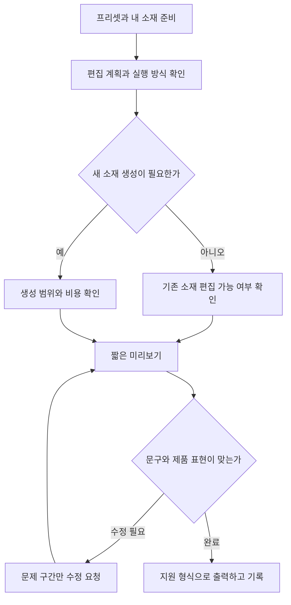

# 클로드·카타나로 영상 프리셋 재편집하기

> [!abstract] 이 문서로 할 수 있는 일
> 마음에 드는 영상의 편집 방식이나 Katana 프리셋을 출발점으로 삼아, 내 제품·브랜드 소재를 넣은 영상을 Claude에 요청한다. 준비물, 시작 경로, 비용 확인, 편집 지시, 한글 자막 수정, 최종 검수까지 한 번에 사용할 수 있도록 정리했다.

> [!important] 확인 범위와 보강 내용
> Threads 원문 **본문**을 확인했다. 작성자가 답글에 올렸다고 설명한 결과 영상은 로그인 화면에 가려져 확인하지 못했다. 따라서 그 영상의 구체적인 장면, 사용 프리셋, 실제 실행 결과를 추정해서 싣지 않았다.
> 아래의 공식 기능 설명은 2026년 10월 10일 확인 기준이다. **예시 브랜드, 편집 구성, 시간표, 프롬프트 12개와 검수 기준은 실무용으로 새로 작성한 보강 자료**이며, 공식 프리셋이나 테스트 완료된 실행 결과가 아니다.

## 1. 원문이 말하는 핵심

원문 작성자 `@prompt_what`은 Higgsfield의 Katana를, Claude에서 프리셋을 고르고 내 영상을 넣어 기존 편집의 컷 타이밍·글자·효과를 재활용하는 방식으로 소개한다. 작성자는 이를 클라우드에서 코드를 실행하는 편집이라고 설명하며, 생성 모델을 부르지 않아 편집 크레딧을 쓰지 않고 베이스 영상 준비에만 비용이 든다고 주장한다. 직접 만든 예시는 답글에 있다는 안내도 포함되어 있다. [S1]

이 문서의 출발점은 **‘새 영상을 매번 처음부터 만들기보다, 원하는 편집 구조를 정하고 내 소재에 적용한다’**는 작업 방식이다. 다만 원문의 비용·구현 설명을 Katana 전체에 그대로 적용하면 안 된다.

## 2. 공식 안내와 구분해서 이해하기

| 항목 | 확인한 내용 | 실제 사용 시 해석 |
|---|---|---|
| 시작 경로 | 공식 Katana 페이지에 Claude 설치 링크와 `/katana` 안내가 있다. [S2] | 먼저 연결을 끝내고 명령을 사용한다. |
| 내 영상 활용 | 공식 페이지는 참고 영상과 내 자산으로 자신만의 버전을 만드는 경로를 제공한다. [S2] | ‘내 영상’과 ‘참고할 편집 영상’의 역할을 분명히 적는다. |
| 모델 사용 | 공식 출시 안내는 MCP를 통한 Higgsfield 모델 사용을 설명한다. [S3] | 모든 프리셋이 코드 편집만 수행한다고 단정할 수 없다. |
| 입력 이미지 | 출시 안내의 일반 편집 참조 이미지는 최대 5장이다. [S3] | 상품·인물·의상 식별에 필요한 대표 이미지를 우선한다. |
| 프리셋 종류 | 공식 분류는 Aura Farming, Motion, Clipping이다. [S3] | 분위기 중심, 모션 중심, 클립 편집 중심이라는 의미로 참고하되 실제 미리보기를 보고 고른다. |

> [!warning] ‘0크레딧’은 확인된 보편 조건이 아니다
> 원문에는 무료 코드 편집이라는 설명이 있지만, 확인한 공식 자료만으로 **모든 Katana 작업이 무료이며 생성 모델을 쓰지 않는다**고 확정할 수 없다. 프리셋에 따라 실행 내용이 다를 가능성은 있으나, 이것도 실제 선택한 작업에서 확인해야 한다. 아래 프롬프트는 모델 호출과 예상 비용을 먼저 확인하도록 설계했다. 프롬프트만으로 과금을 기술적으로 차단하는 것은 아니므로 실행 화면의 도구·비용 표시도 확인한다.

실무에서는 비용을 세 칸으로 나누어 기록하면 혼동이 줄어든다.

| 비용 구분 | 확인할 질문 |
|---|---|
| 소스 준비 | 촬영, 유료 소재 구입, 베이스 이미지·영상 생성이 필요한가? |
| 이번 실행 | 선택한 프리셋이 기존 소재만 편집하는가? 새 이미지·영상·음성을 만드는가? 예상 차감이 표시되는가? |
| 이용 환경 | Claude와 Higgsfield 계정의 사용 조건·한도에 걸리는가? 내 계정에서 확인 가능한가? |

**확인되지 않은 금액이나 무료 조건을 임의로 적지 않는다.** 이 문서에서도 특정 요금제, 무료 횟수, 출력 한도는 보장하지 않는다.

## 3. 처음 시작하는 순서

### 3-1. 공식 연결 경로

1. [Katana 공식 페이지](https://higgsfield.ai/katana)를 연다.
2. **Install Higgsfield in Claude**에서 연결 안내를 따른다. 이미 연결되어 있으면 Claude에서 `/katana`를 입력한다. [S2]
3. 프리셋을 살펴보고 사용할 항목을 정한다. 공식 출시 안내의 경로는 프리셋 선택 → 이미지 업로드 → **Recreate in Claude**다. [S3]
4. 내 영상을 활용하려면 공식 페이지의 **Create from your own video** 경로를 살펴본다. [S2]
5. 실행 전에 아래 ‘01번 프롬프트’로 입력 파일, 작업 방식, 예상 비용을 정리한다.

연결이 보이지 않으면 [Higgsfield MCP 안내](https://higgsfield.ai/mcp?tab=claude)의 **Connect Higgsfield**를 확인한다. MCP는 여기서 Claude가 Higgsfield 기능에 접근하는 연결 방식이라고 이해하면 된다. [S4] 메뉴 위치나 계정별 제공 범위는 화면 안내를 따른다.

### 3-2. 준비물

| 준비물 | 권장 준비 방식 — 실무 보강 |
|---|---|
| 프리셋 또는 참고 영상 | 어떤 컷 전환·자막·효과를 참고할지 한 줄로 적는다. |
| 내 제품·인물·브랜드 소재 | 대표 컷과 보조 컷을 구분하고 파일명을 명확히 한다. |
| 로고와 정확한 문구 | 로고 파일, 브랜드명, 자막, 마지막 행동 유도 문구를 따로 준비한다. |
| 목표 길이·비율 | 예: 15초, 세로 9:16. 아래 수치는 작업 요청 예시이며 서비스 지원 보장이 아니다. |
| 유지 조건 | 제품 형태, 색상, 로고, 인물, 컷 순서 중 반드시 지켜야 할 것을 정한다. |
| 허용하는 변경 | 자막·크롭·전환·색상 등 바꿔도 되는 범위를 적는다. |

파일명 예시: `참고편집.mp4`, `내제품_정면.png`, `내제품_사용장면.mp4`, `브랜드로고.png`.

프롬프트 안의 파일명은 **실제로 첨부한 이름과 같게** 바꾼다. 이름을 텍스트로 적는 것만으로 파일이 전달되지는 않는다.

## 4. 작업 흐름 시각화

다음은 공식 화면 캡처가 아니라, 비용과 수정 범위를 놓치지 않도록 직접 정리한 흐름도다. Obsidian 읽기 보기에서 Mermaid로 표시할 수 있다.



## 5. 프롬프트를 쓰는 기본 공식

**목표 + 첨부물의 역할 + 참고할 편집 요소 + 바꿀 내용 + 유지할 내용 + 출력 요청 + 실행 조건**을 함께 쓴다.

예를 들어 ‘이렇게 만들어줘’ 대신, ‘참고영상의 컷 간격과 자막 등장 순서를 참고하고, 화면 소재와 문구는 내 제품으로 교체해줘. 로고·색상·제품 형태는 유지하고, 새 생성이 필요하면 실행 전 알려줘’라고 요청한다.

> [!tip] 아래 프롬프트 사용법
> 각 코드 블록은 바로 복사할 수 있다. `[대괄호]` 값만 바꾸고 필요한 파일을 첨부한다. `/katana`는 연결 후 실행하는 공식 시작 명령이다. 그 외 아래 문장은 **직접 작성한 자연어 작업 지시**이며 별도 공식 명령이 아니다.
> ‘지원하면’, ‘가능한 형식으로’라고 쓴 기능은 실제 환경 확인이 필요하다. 원본 컷 타이밍의 완전한 일치, 자막 레이어 편집, 특정 프로젝트 파일 제공을 미리 보장하지 않는다.

## 6. 상황별 복붙 프롬프트 12개

### 01. 첫 실행 — 작업 방식과 비용부터 확인

**언제:** 처음 연결하거나 새로운 프리셋을 선택했을 때.

```text
선택한 Katana 프리셋과 첨부한 소재로 [제품/브랜드명] 영상을 만들고 싶어.
목표는 [15초 / 세로 9:16]이고, 용도는 [신제품 소개 릴스]야.

먼저 다음을 확인해줘.
1. 첨부 파일을 실제로 읽을 수 있는지와 각 파일의 역할.
2. 이 프리셋이 기존 소재 편집만으로 실행 가능한지.
3. 새 이미지·영상·음성 생성 모델이 필요한지와 필요한 이유.
4. 확인 가능한 예상 크레딧 또는 비용. 확인할 수 없으면 미확인이라고 표시.
5. 지원하는 미리보기·최종 출력 형식과 원하는 길이·비율의 가능 여부.

아직 생성·렌더 작업은 시작하지 말고 편집 계획을 표로 보여줘.
내가 계획을 확인하면 그 범위 안에서 진행해줘.
```

### 02. 내 영상에 프리셋의 컷·자막·효과 적용

**언제:** 원문에서 소개한 ‘프리셋 구조 + 내 영상’을 시도할 때.

```text
첨부한 [내영상.mp4]를 선택한 Katana 프리셋의 편집 방식으로 재구성해줘.
내영상은 실제 사용할 화면 소재이고, 프리셋은 편집 리듬의 참고야.

참고할 요소: 컷 간격, 자막이 나타나는 순서, 전환의 속도, 강조 효과의 위치.
교체할 요소: 화면 소재, 브랜드명, 자막 문구.
유지할 요소: 내 영상 속 제품의 형태·색상·로고와 인물의 모습.
자막: [첫 문구] / [핵심 설명] / [마지막 행동 유도 문구].
목표: [15초 / 세로 9:16].

기존 소재만 사용하는 편집을 우선해줘. 그대로 재현할 수 없는 요소는 먼저 설명해줘.
생성 모델이 필요하거나 비용을 확인할 수 없으면 실행 전에 알려줘.
가능한 경우 짧은 미리보기를 먼저 보여주고, 어떤 편집 요소를 적용했는지 정리해줘.
```

### 03. 참고 영상의 구성으로 제품 광고 만들기

**언제:** 내 영상과 참고 영상의 역할이 섞이기 쉬울 때.

```text
[참고편집.mp4]의 구성 원리를 분석해서 내 제품 소개 영상을 계획해줘.
[내제품_정면.png]과 [내제품_사용장면.mp4]가 실제 사용할 소재야.

참고할 것은 도입부 길이, 제품 공개 순서, 자막 밀도, 장면 전환의 리듬이야.
참고 영상에 있는 타사 로고와 광고 문구는 사용하지 말고 새 문구를 제안해줘.
브랜드명: [브랜드명]
확인된 제품 특징: [특징 1], [특징 2]
마지막 문구: [자세히 보기]
목표: [15초 / 9:16].

먼저 시간대 / 사용할 내 파일 / 자막 / 전환 방식의 4열 구성표를 작성해줘.
첨부 소재로 가능한 부분과 새 소재가 필요한 부분을 구분해줘.
새 생성은 내가 범위와 비용을 확인한 뒤 진행해줘.
```

### 04. 신제품 출시 — 15초 구성 예시

**언제:** 자료는 있지만 광고 전개가 막힐 때. 아래 브랜드·문구는 가상 예시다.

```text
첨부한 루미컵 텀블러 사진과 사용 영상을 활용해 15초 세로 제품 소개를 계획해줘.
브랜드는 LUMICUP이고 분위기는 밝고 단정하게 잡아줘.
새로운 제품 성능이나 수치를 만들어내지 말고 아래 문구만 사용해줘.

0~3초: 제품 전체가 보이는 컷. 문구는 '매일 손이 가는 한 잔'.
3~8초: 첨부한 사용 장면. 문구는 '책상 위에서, 이동 중에도'.
8~12초: 제품 디테일 컷. 문구는 '당신의 일상에 루미컵'.
12~15초: 로고와 제품 컷. 문구는 'LUMICUP · 자세히 보기'.

제품 형태와 로고를 유지하고, 텍스트가 제품의 주요 부분을 가리지 않게 해줘.
선택한 프리셋이 이 시간표를 지원하지 않으면 가능한 수정안을 먼저 보여줘.
기존 소재만으로 가능한지와 실행 비용 확인 상태를 먼저 알려줘.
```

### 05. 카페·매장 소개 — 촬영한 클립 재활용

**언제:** 매장 외관·공간·대표 메뉴를 짧게 소개할 때.

```text
첨부한 [외관.mp4], [공간.mp4], [메뉴.mp4]로 [매장명] 소개 영상을 만들어줘.
용도는 방문 전 분위기를 보여주는 세로 영상이고 목표 길이는 12초야.

편집 순서: 외관으로 시작 → 공간 분위기 → 대표 메뉴 → 매장명.
자막은 '[동네명]에서 쉬어가는 시간', '[대표 메뉴명]', '[매장명]'으로 제한해줘.
실제 첨부된 공간과 메뉴만 보여주고, 없는 시설이나 가격·행사 정보를 추가하지 마.
급격한 확대보다 차분한 컷 전환을 우선하고 메뉴가 선명하게 보이게 해줘.

먼저 선택한 Katana 프리셋에 이 구성이 맞는지와 소재 부족 여부를 알려줘.
생성 모델 없이 가능한 범위를 제시하고, 지원하는 미리보기부터 진행해줘.
비용이 발생하거나 확인되지 않은 작업은 실행 전에 설명해줘.
```

### 06. 디자이너 포트폴리오 — 작품 이미지 소개

**언제:** 완성된 디자인 시안 여러 장을 짧은 소개 영상으로 만들 때.

```text
첨부한 [대표작.png], [상세1.png], [상세2.png]로 포트폴리오 소개 영상을 계획해줘.
프로젝트명은 [이름], 디자인 의도는 [한 문장]이야.
길이는 15초, 비율은 9:16을 요청할게. 지원하지 않으면 가능한 형식을 알려줘.

첫 화면은 프로젝트명, 중간은 전체 디자인과 세부 요소, 끝은 [이름/계정명]으로 구성해줘.
첨부 디자인의 글자·로고·레이아웃을 다시 생성하거나 임의로 바꾸지 마.
기존 이미지의 위치·크기 변화와 장면 전환으로 움직임을 만드는 방식이 가능한지 확인해줘.
화려한 효과보다 작품의 글자와 디테일이 읽히는 것을 우선해줘.

구성표와 예상 실행 방식을 먼저 제시하고 새 이미지·영상 생성은 먼저 확인받아줘.
```

### 07. 한글 자막 — 자연스러운 번역과 줄바꿈

**언제:** 영어 프리셋 문구를 한국어로 바꾸거나 한글이 너무 길 때.

```text
현재 편집의 화면 구성과 컷 순서는 유지하고 자막을 한국어로 정리해줘.
원문 문구: [원문 전체]
전달할 의미: [핵심 메시지]
정확히 유지할 이름·숫자: [브랜드명 / 모델명 / 숫자]

먼저 원문 / 자연스러운 한국어 / 화면용 짧은 문구의 3열 표를 보여줘.
한 화면에 한 메시지만 두고, 가능한 한 두 줄 이내로 구성해줘.
글자 수를 맞추기 위해 의미나 수치를 바꾸지는 마.
문구가 길면 글자를 무조건 줄이기보다 문장을 나누는 안을 제안해줘.

내가 문구를 정하면 지원하는 한글 글꼴과 렌더링 상태를 확인해줘.
텍스트만 수정할 수 있는지 먼저 알려주고, 가능하면 영상 소재는 재생성하지 마.
```

### 08. 첫 3초 훅 — 같은 영상으로 세 가지 버전

**언제:** 광고 도입부를 비교하고 싶을 때.

```text
현재 영상의 3초 이후 구간과 마지막 행동 유도 문구는 그대로 두고,
첫 3초의 자막과 컷 배치만 다른 A/B/C안을 제안해줘.

A: 사용 상황을 보여주는 시작.
B: 제품 디테일을 먼저 보여주는 시작.
C: 핵심 메시지를 한 문장으로 보여주는 시작.
제품의 확인된 정보는 [정보]이고, 사용할 소재는 기존 첨부 파일로 제한해줘.

먼저 세 안의 첫 문구 / 화면 / 예상 차이를 표로 비교해줘.
세 버전을 바로 렌더하지 말고 내가 선택한 안 하나부터 미리보기로 만들어줘.
기존 구간을 그대로 재사용할 수 있는지, 추가 모델 호출이나 비용이 있는지 알려줘.
성능 향상이나 조회 수를 보장하는 표현은 쓰지 마.
```

### 09. 세로·정사각형·가로로 재배치

**언제:** 동일한 콘텐츠를 여러 화면 비율에 맞추고 싶을 때.

```text
완성한 영상의 메시지와 장면 순서를 유지하면서 9:16, 1:1, 16:9 버전을 계획해줘.
먼저 현재 도구에서 지원하는 출력 비율과 해상도를 확인해줘.

비율별로 제품 위치, 자막 줄바꿈, 로고 위치를 조정해줘.
가로 영상을 단순히 잘라서 제품이나 얼굴이 사라지는 방식은 피하고,
원본 화면을 유지하는 여백 배치와 필요한 크롭 범위를 먼저 제안해줘.
중요한 문구는 화면 가장자리에 붙이지 말고 실제 게시 화면에서 가림 여부를 확인할 수 있게 해줘.

새 배경 생성이 필요한 경우 기존 소재 배치 대안과 함께 알려줘.
세 가지를 한꺼번에 렌더하지 말고 배치안 확인 후 선택한 형식부터 진행해줘.
추가 비용이나 모델 호출은 실행 전에 설명해줘.
```

### 10. 마음에 안 드는 구간만 수정

**언제:** 전체는 괜찮지만 자막·효과 일부만 고치고 싶을 때.

```text
현재 결과의 나머지 부분은 유지하고 아래 구간만 수정하고 싶어.

대상 구간: [00:04~00:07]
현재 문제: [자막이 제품 로고를 가림]
원하는 변경: [자막을 위쪽으로 옮기고 두 줄로 배치]
유지 조건: 영상 소재, 전체 길이, 컷 순서, 다른 구간 자막, 배경음.

해당 구간이나 텍스트만 수정할 수 있는지 먼저 확인해줘.
전체 재렌더나 새 모델 호출이 필요하면 이유와 비용 확인 상태를 알려줘.
가능한 경우 변경 구간 미리보기부터 보여줘.
마지막에 수정한 항목과 그대로 유지한 항목을 짧게 기록해줘.
```

### 11. 비용·생성 최소화 — 기존 소재만으로 대안 찾기

**언제:** 프리셋이 새로운 영상 생성을 요구하거나 크레딧이 걱정될 때.

```text
이번 작업의 우선순위는 첨부한 기존 소재만 활용하는 거야.
새 이미지·영상·음성 생성, 유료 소재 추가, 불필요한 여러 버전 출력은 하지 마.

선택한 프리셋에서 위 조건으로 가능한 편집을 먼저 확인해줘.
가능한 작업과 불가능한 작업을 분리하고,
불가능한 효과는 컷 편집, 기존 이미지 배치, 텍스트 변화로 대체할 수 있는지 제안해줘.
코드 기반 편집이 지원되는지도 확인하되 지원 여부를 추정하지 마.

실행 전에 실제 사용할 도구와 확인 가능한 비용을 설명해줘.
확인할 수 없는 비용은 0이라고 말하지 말고 미확인으로 표시해줘.
이 환경에서 조건을 지킬 수 없다면 실행하지 말고 수동 편집용 시간표를 만들어줘.
```

### 12. 최종 납품·다음 작업용 기록

**언제:** 결과를 저장하고 같은 스타일을 다음 제품에도 재사용할 때.

```text
현재 결과를 최종 출력하기 전에 다음을 확인해줘.
브랜드명: [정확한 이름]
필수 문구: [정확한 문구]
목표 길이·비율: [길이 / 비율]

자막 오탈자, 글자 잘림, 제품·로고 변형, 첫 장면과 마지막 장면을 점검해줘.
지원하는 출력 형식을 알려주고 선택한 형식으로 최종 파일을 제공해줘.
편집 가능한 프로젝트나 소스 파일이 실제 제공 가능하면 함께 안내하고,
제공할 수 없으면 있다고 말하지 마.

다음 작업을 위해 사용 프리셋, 첨부 파일 목록, 최종 문구, 시간대별 구성,
실제로 변경한 부분, 확인 가능한 비용을 마크다운으로 정리해줘.
자동 게시하거나 커뮤니티 프리셋으로 공개하지 말고 결과 파일과 기록만 제공해줘.
```

## 7. 실무 예제 — 한 제품으로 첫 결과 만들기

이 절은 직접 만든 진행 예시다. 실제 실행을 완료한 사례가 아니다.

| 순서 | 할 일 | 복사할 프롬프트 |
|---|---|---|
| 1 | 제품 정면 이미지, 사용 영상, 로고를 첨부한다. | 01 |
| 2 | 프리셋에서 참고하고 싶은 컷·자막·효과를 정한다. | 02 |
| 3 | 제품명이 들어간 15초 구성안을 만든다. | 04 |
| 4 | 한글이 길거나 어색하면 문구를 다듬는다. | 07 |
| 5 | 첫 미리보기에서 문제 구간을 지정한다. | 10 |
| 6 | 최종 출력과 재사용 기록을 받는다. | 12 |

**예시 편집표 — 프롬프트 04의 LUMICUP 구성**

| 시간 | 화면 역할 | 자막 | 검수 기준 |
|---|---|---|---|
| 0~3초 | 제품 인지 | 매일 손이 가는 한 잔 | 첫 화면에서 무엇을 소개하는지 보이는가? |
| 3~8초 | 사용 상황 | 책상 위에서, 이동 중에도 | 실제 제공된 사용 장면인가? |
| 8~12초 | 제품 디테일 | 당신의 일상에 루미컵 | 로고·형태가 원본과 같은가? |
| 12~15초 | 브랜드와 다음 행동 | LUMICUP · 자세히 보기 | 마지막 문구를 읽을 시간이 있는가? |

실제 프리셋의 구조와 소스 길이에 따라 시간표는 조정한다. 효과 종류보다 **제품 인지 → 사용 맥락 → 핵심 문구 → 다음 행동**이 연결되는지를 먼저 본다.

## 8. 막혔을 때 해결표

| 증상 | 먼저 확인할 것 | 다음 행동 |
|---|---|---|
| `/katana`가 동작하지 않음 | Higgsfield 연결 상태, 공식 페이지 안내 | 공식 연결 경로를 다시 확인하고 프리셋 페이지에서 시작한다. |
| 파일을 읽지 못함 | 실제 첨부 여부, 파일명, 업로드 완료 상태 | 읽을 수 있는 파일 목록부터 요청한다. |
| 내 소재 대신 새 장면이 나옴 | 프리셋의 모델 사용 방식, 소재 역할 지시 | 11번으로 기존 소재 사용 가능 여부부터 재확인한다. |
| 참고 영상과 타이밍이 다름 | 원본 길이, 선택 프리셋 제약 | 유지할 전환 시점을 구간별로 적고 가능한 범위를 확인한다. |
| 한글이 깨지거나 너무 작음 | 글꼴 지원, 문장 길이, 화면 크기 | 07번으로 문구를 줄이고 한글 렌더링을 확인한다. |
| 제품·로고가 달라짐 | 새 생성 발생 여부, 원본 교체 가능 여부 | 제품이 보이는 구간에 원본 소재 사용을 요청한다. |
| 일부 수정인데 전체가 바뀜 | 수정 범위, 부분 편집 지원 여부 | 10번에 유지 조건을 명시하고 지원 범위를 확인한다. |
| 비용을 알 수 없음 | 실행 화면의 예상 차감, 호출 도구 | 미확인 상태에서 무료로 가정하지 않고 작업 계획까지만 받는다. |
| 프로젝트 파일이 제공되지 않음 | 실제 내보내기 지원 | 결과 영상과 시간표·자막·사용 소재 기록을 따로 보관한다. |

## 9. 완성 후 체크리스트

- [ ] 제품, 인물, 로고가 의도한 모습으로 유지되었다.
- [ ] 한국어 문구, 브랜드명, 숫자에 오탈자가 없다.
- [ ] 제품과 핵심 자막이 크롭되거나 다른 요소에 가려지지 않는다.
- [ ] 참고하고자 한 컷 리듬과 효과가 적절하게 반영되었다.
- [ ] 사실로 제공하지 않은 제품 성능·가격·행사가 추가되지 않았다.
- [ ] 음원을 사용했다면 게시에 사용할 수 있는 소재인지 확인했다.
- [ ] 최종 파일이 재생되며, 요청한 길이·비율과 실제 값이 맞는다.
- [ ] 프리셋, 입력 파일, 최종 프롬프트, 자막, 수정 내용을 기록했다.

## 10. 용어 한글 풀이

| 표현 | 한글 의미 |
|---|---|
| Preset | 편집 스타일이나 작업 방식을 재사용하기 위한 미리 설정된 구성 |
| Reference video | 컷 구성·움직임·스타일을 참고할 영상 |
| Assets | 실제 작업에 넣을 영상, 이미지, 로고 등 소재 |
| Base video | 편집의 바탕으로 쓰는 원본 또는 준비된 영상 |
| Cut timing | 장면이 바뀌는 시점과 각 장면의 길이 |
| Motion graphics | 글자·도형·이미지 등 그래픽 요소에 움직임을 준 표현 |
| Hook | 시작 부분에서 관심을 끄는 문구나 장면 |
| CTA | 자세히 보기·방문하기 등 다음 행동을 안내하는 문구 |
| Render | 편집 내용을 실제 재생 가능한 영상 파일로 만드는 과정 |
| Recreate in Claude | 선택한 구성을 Claude에서 내 소재로 다시 만드는 시작 버튼 |

## 11. 커뮤니티 프리셋 만들기는 별도 기능

내 영상을 편집하는 것과 **프리셋을 공개하는 것**은 구분한다. 공식 출시 안내는 커뮤니티 프리셋 제작에 3~30초 움직임 참고 영상, 최대 40장 이미지와 이미지 `@` 언급 프롬프트를 설명한다. 이는 일반 편집 참조 이미지 5장 안내와 다른 용도다. 공유된 프리셋은 바로 공개되므로 개인 작업 저장과 혼동하지 않는다. [S3]

이 가이드의 기본 목표는 개인 결과물 제작과 기록이다. 커뮤니티 공개는 필요할 때 별도로 진행한다.

## 12. 출처와 확인 기록

| 기호 | 출처 | 문서에 반영한 범위 |
|---|---|---|
| S1 | [Threads 원문 · @prompt_what](https://www.threads.com/@prompt_what/post/DeQK0qAioba) · [사용자가 준 공유 링크](https://www.threads.com/share/BAWErZaalI/) | 게시글 본문 요약. 답글 결과 영상은 미확인. |
| S2 | [Higgsfield Katana 공식 페이지](https://higgsfield.ai/katana) | Claude 연결, `/katana`, 내 영상 활용 경로. |
| S3 | [Higgsfield 공식 변경 기록](https://higgsfield.ai/creator-hub/changelog) · 2026-10-08 Katana 항목 | 모델 사용, 분류, 입력 이미지 수, 시작 경로, 커뮤니티 프리셋 조건. |
| S4 | [Higgsfield MCP 공식 안내](https://higgsfield.ai/mcp?tab=claude) | Claude 연결 경로와 MCP 역할. |

확인일: **2026-10-10**. 실제 로그인 연결, 프리셋 실행, 크레딧 차감, 영상 생성·출력 테스트는 수행하지 않았다. 이 문서는 원문과 공식 공개 자료를 대조해 만든 실무 가이드다. 원문 전체 복제 대신 핵심을 요약하고, 부족한 작업 지시는 별도로 보강했다.
