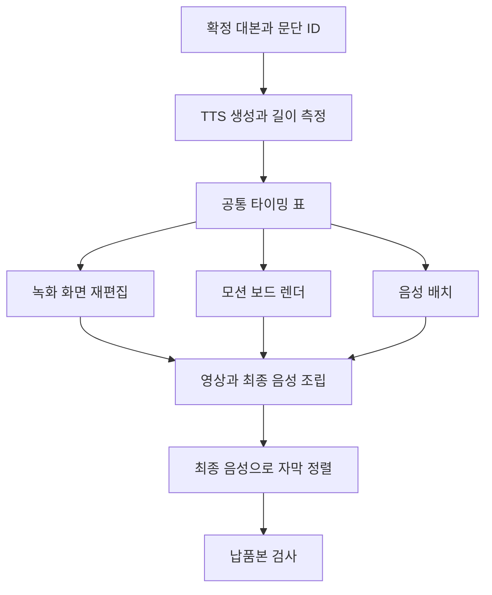

# AI 롱폼 영상 재편집과 음성·자막 동기화 실무 가이드

> **언제 쓰나:** 설명 영상이 너무 길거나, 직접 녹음과 TTS가 섞여 있거나, 대본을 수정할 때마다 화면과 자막이 어긋나는 상황.
>
> **핵심:** 대본을 먼저 확정하고, 실제 생성한 음성 길이로 타임라인을 다시 만든다. 그 타임라인을 화면·모션그래픽·자막이 함께 사용하게 한다.

링크의 **「effort 5단계 편 재편집」 작업 기록**을 읽고, 한글 실무 절차와 새 예시 프롬프트를 보강한 가이드다. 원문의 결과는 작성자의 보고이며, 실제 영상·프로젝트 파일을 받아 재측정한 결과가 아니다. 아래 프로젝트 구조, 시간 배분표, JSON, 프롬프트는 이 가이드에서 새로 만든 적용안이다.

## 1. 원문에서 확인한 작업과 결과

원문은 같은 요청으로 만든 다섯 단계의 영상 결과를 소개하는 콘텐츠를 재편집한 사례다. 특정 모델이나 effort 단계의 일반적인 성능 순위를 검증하는 자료로 해석하면 안 된다.

| 항목 | 이전 버전 | 재편집 버전 |
|---|---|---|
| 전체 길이 | 약 13분 1초, 세부 수치 781.4초 | 480초, 8분 |
| 목소리 | 일부 직접 녹음 + TTS | 채널 TTS로 통일 |
| 진행 방식 | 추천과 평가 중심 | 이번 실험에서 관찰한 결과 중심 |
| 도입 | 여러 결과를 짧게 번갈아 노출 | 가장 눈에 띄는 결과를 먼저 보여줌 |
| 과정 설명 | E3 구간 약 7분 21초 | 약 2분 4초 |
| 완성 결과 | 다섯 영상 각 15초 | 다섯 결과의 총 75초 유지 |

단축량은 **301.4초, 약 38.6%**다. 핵심 결과물을 무조건 배속한 것이 아니라, 반복되는 과정 설명을 줄여 길이를 확보했다.

원문 요청 여덟 가지:

1. 전체 길이를 줄인다.
2. 목소리를 TTS로 통일한다.
3. 단정적인 추천 표현을 줄이고 실험 보고 말투로 바꾼다.
4. max 결과를 도입에 배치한다.
5. 인터넷 연결을 끊는 내용을 뺀다.
6. 마지막에 좋아요·구독 안내를 넣는다.
7. 도입 화면 왼쪽 위 라벨을 없앤다.
8. ‘일꾼’ 표현을 ‘서브에이전트’로 바꾼다.

대본 확정, 발음 검사, 74개 문단 음성 생성, 음성 길이 기반 타이밍 계산, 녹화 화면 재편집, 모션 보드 9개 갱신, 21개 블록 조립, 음량 정리, 209개 자막 큐 보정, 자막 합성, 최종 검사가 이어졌다. 세 번의 빌드 길이는 477.0초 → 477.8초 → 480.0초로 보고됐다. 원문에서 사용한 Fish Audio, mlx_whisper와 스크립트 이름은 **해당 제작자의 도구 구성**이며 필수 설치 목록은 아니다.

## 2. 작업 시작 전에 준비할 것

| 준비물 | 최소 내용 | 없을 때 생기는 문제 |
|---|---|---|
| 원본 영상 | 수정 전 완성본, 가능하면 화면 녹화 원본 | 잘린 화면 복원 어려움 |
| 대본 | 문단별 ID와 실제 발화 문장 | 수정 영향 추적 불가 |
| 결과물 목록 | 반드시 유지할 시연·완성 영상 | 중요한 결과까지 압축 |
| 원본 오디오 | 녹음, TTS, 음악, 효과음 구분 | 목소리 겹침 |
| 화면 근거 | 수치·버튼·질문이 보이는 프레임 | 기억에 의존한 설명 |
| 납품 조건 | 길이, 화면비, fps, 자막 방식 | 끝에서 전체 재작업 |
| 사용할 글꼴 | 한글 지원과 사용 권한 확인 | 자막 네모·서체 대체 |

원본을 덮어쓰지 않고 새 편집 버전을 만든다. 이는 **영상 제작 시 버전 관리** 원칙이며, 자료 정리 때 같은 파일을 여러 폴더에 복제하라는 의미는 아니다.

| 프로젝트 경로 예시 | 역할 |
|---|---|
| source/ | 원본 영상·오디오·결과 영상 |
| edit/v1/script.md | 확정 대본 |
| edit/v1/manifest.json | 문단과 화면의 대응 정보 |
| audio/v1/ | 문단별 생성 음성 |
| timing/v1/beats.json | 실제 길이로 계산한 구간 |
| renders/v1/ | 재편집 화면과 모션그래픽 중간 결과 |
| output/v1/ | 최종 영상과 자막 |
| qa/v1/ | 검사 결과, 수정 이력, 검토 이미지 |

## 3. 8분 영상으로 줄이는 편집 설계

다음은 **새로 만든 시간 배분 예시**다. 원문의 실제 컷별 타임코드가 아니다.

| 구간 | 길이 | 해야 할 일 |
|---|---:|---|
| 결과 선공개 | 25초 | 가장 강한 결과 + 오늘 비교할 질문 |
| 조건 설명 | 40초 | 같은 점, 다른 점, 비교 한계 |
| 제작 과정 | 125초 | 중요한 의사결정과 차이만 |
| 결과 다섯 개 | 75초 | 각 15초를 온전히 감상 |
| 차이 비교 | 135초 | 관찰 근거와 예외 설명 |
| 정리 | 65초 | 상황별 선택 기준과 재현 조건 |
| 마무리 | 15초 | 다음 행동 한 가지 |
| **합계** | **480초** | **8분** |

줄이는 순서는 **반복 문장 → 입력·로딩·대기 → 과도한 예고 → 불필요한 과정**이다. 결과와 근거는 필요한 길이만큼 보여준다. 그래도 길면 대본 구조를 고친다.

“이 문장이 빠지면 시청자가 결과를 이해하지 못하는가?”라는 질문에 아니라면 삭제·통합 후보로 표시한다. 작업 시간이 오래 걸렸다는 이유만으로 영상에서도 길게 보여줄 필요는 없다.

## 4. 실제 제작 순서: 열 단계

### 1단계 — 대본과 사실 확정

문단 ID는 001, 002처럼 유지한다. 문장을 고치더라도 ID를 매번 다시 매기지 않으면 음성과 화면의 대응을 추적하기 쉽다.

원문에서는 화면에 나온 질문 수, 결과 영상의 실제 콘셉트, 글자 수 표기 등을 다시 확인했다. 실무에서도 **기억·대본·녹화가 충돌하면 실제 화면과 로그를 확인**한다. 화면만으로 확인되지 않는 소리 특성은 직접 청취하고, 근거가 없으면 삭제하거나 미확인으로 남긴다.

| 피할 표현 | 보고형 표현 |
|---|---|
| 이 단계가 무조건 제일 좋습니다 | 이번 조건에서는 이 결과가 가장 적합했습니다 |
| 질문을 전혀 하지 않았습니다 | 녹화에서 확인된 질문은 두 가지였습니다 |
| 이 모델은 항상 빠릅니다 | 이번 실행에서 확인한 소요 시간은 이렇습니다 |
| 시네마틱한 저음이 들어갔습니다 | 저음 특성은 별도 청취 확인이 필요합니다 |

### 2단계 — 발음 사전과 TTS 생성

대본의 **화면 표기**와 **읽는 방법**을 구분한다.

| 화면 표기 예시 | 읽기 예시 | 주의 |
|---|---|---|
| v1 | 브이 원 | 팀 관례에 맞춰 고정 |
| 16:9 | 십육 대 구 | 비율로 읽기 |
| 11,172 | 만 천백칠십이 | ‘자’ 등 단위와 확인 |
| TTS | 티티에스 | 첫 등장에서는 의미 설명 |
| 제품명 | 확정한 발음 | 발음 사전에 고정 |

먼저 3~5개 문단으로 샘플을 만든다. 목소리·속도·숫자 발음을 확정한 후 전체를 생성한다. 문단 수, 생성된 파일 수, 빈 파일 유무를 대조한다.

원문에서 짧은 문장이 사라진 문제는 **10자 미만 문단을 버리는 자체 파서 조건** 때문이었다. TTS의 보편적인 제한이 아니다. 의미 없는 말을 추가하기보다 길이 필터를 수정하고 짧은 문장도 생성됐는지 검사한다.

### 3단계 — 실제 음성 길이로 타임라인 계산

대본 글자 수는 길이 추정용이다. 최종 배치는 실제 오디오 길이로 계산한다.

- 원음 길이 D초, 재생 속도 r배라면 예상 길이 = D ÷ r.
- 무음 제거·앞뒤 패딩까지 끝낸 음성을 다시 측정한다.
- 문단 시작 = 이전 문단 종료 + 의도한 간격.
- 배치 프레임 = 초 × fps를 프로젝트 규칙에 따라 정수화한다.
- 매 문단 길이를 반올림해 더하기보다 **누적 경계 시간을 프레임으로 변환**하면 반올림 오차 누적을 줄일 수 있다.

예: 12초 음성을 1.2배로 재생하면 약 10초다. 60fps에서는 600프레임이다. 실제 파일 길이와 인코딩 후 결과를 다시 확인한다.

### 4단계 — 녹화 화면을 음성에 맞추기

각 문단에서 **설명의 증거가 되는 구간**을 고른다. 원본 구간이 L초, 배치 시간이 T초라면 필요한 속도는 L ÷ T다. 24초를 10초에 넣으려면 2.4배다.

너무 빠르면 시작·끝의 대기를 제거하고, 중요한 동작만 남기고, 확대·정지 프레임·강조 표시로 읽을 시간을 준다. 그래도 맞지 않으면 대본이나 배치 시간을 바꾼다. 마지막 음절을 잘라서 억지로 맞추지 않는다.

화면이 짧으면 끝 프레임을 잠시 유지할 수 있다. 다만 정지된 로딩 화면을 의도된 결과처럼 보이게 하지 않는다. 녹화의 목소리를 제거하고 TTS를 얹을 때 보존할 효과음은 별도 트랙으로 분리한다.

원문의 화면 배속은 대체로 1.3~3배였지만, 이는 그 녹화에 맞춘 값이다. 모든 설명 영상의 기준은 아니다.

### 5단계 — 모션그래픽을 동일 타임라인으로 배치

보드마다 시간을 다시 입력하는 대신 확정한 문단 ID와 시작·종료 프레임을 읽게 한다. Remotion의 Sequence는 요소의 표시 시점과 길이를 프레임 단위로 배치하는 데 사용할 수 있다.[2][3]

보드는 “키워드 등장 → 비교·강조 → 읽을 시간 → 퇴장”으로 설계한다. 모든 요소를 계속 움직이기보다 설명의 초점 한 곳을 움직인다.



### 6단계 — 블록 조립

화면 크기·fps·오디오 샘플레이트를 프로젝트 기준으로 맞춘다. 각 블록의 시작, 종료, 오디오 유무를 확인한다.

특히 **블록 사이 경계**에서 첫 단어가 잘리는지, 같은 프레임이 과도하게 반복되는지, 음악이 갑자기 튀는지 본다. 문제가 있는 블록 자체를 고친 후 조립한다.

### 7단계 — 최종 믹스 음량 정리

원문 목표는 -16 LUFS와 -1.5 dBTP였다. 이 사례의 목표이며 모든 플랫폼의 고정 의무값은 아니다.

음성·음악·효과음의 상대적인 크기를 먼저 청취로 정리하고 전체 믹스를 측정한다. 정규화 후 최종 AAC 등 실제 납품 파일을 다시 측정한다.

**원문 점검 포인트:** 최종 보고에는 -16.1 LUFS와 “true peak -0.8 dBFS”가 적혀 있다. true peak의 통상 표기는 dBTP다. 보고값을 true peak로 해석하면 목표 -1.5보다 0.7dB 높다. 따라서 이를 “목표 통과”로 옮겨 적으면 안 된다. 인코딩 후 피크 상승, 설정, 측정 단위를 확인해야 한다.

### 8단계 — 최종 음성 기준 자막 정렬

실제 재생되는 최종 음성을 기준으로 정렬한다. 인식 결과는 음성과 대본을 함께 보며 수정한다.

**내용 수정과 시간 이동을 분리**한다. 원문에도 단어가 이웃 큐로 옮겨가면서 전체 문장은 맞지만 읽는 시점이 어긋난 사례가 있었다.

- ID와 시작·종료 시각 보존
- 숫자·브랜드명·영어 약어 우선 확인
- 긴 문장은 표시 길이와 줄바꿈 조정
- 실제 음성에 없는 문장 추가 금지
- 자막 이동이 필요하면 별도 수정 목록 기록

### 9단계 — 자막 합성

분리된 SRT와 자막을 입힌 영상을 함께 관리하면 수정이 쉽다. 먼저 한글, 숫자, 긴 문장, 문장부호가 있는 샘플을 확인한다.

FFmpeg의 subtitles 필터는 libass가 포함된 빌드가 필요하다.[1] 원문 제작자의 특정 Homebrew 빌드에 필터가 없었다는 사실을 모든 운영체제의 제한으로 일반화하지 않는다. 내 환경에서 지원 여부를 확인한다.

### 10단계 — 납품 파일 검사

프로젝트 미리보기와 납품본은 다를 수 있다. 최종 파일을 열고 처음부터 끝까지 확인한다.

- 길이·해상도·프레임레이트·오디오 트랙
- 블록 경계와 첫·마지막 프레임
- 한글 깨짐, 화면 밖 잘림, 글자 크기
- 숫자와 주장, 화면 근거의 일치
- 목소리·효과음·음악의 균형
- 정규화 후 실제 피크
- 모바일에서 녹화 화면 글자가 읽히는지

원문의 10초 간격 이미지와 9개 보드 검사는 유용한 **표본 검사**다. 표본 사이의 짧은 검은 프레임까지 없음을 증명하지는 않는다. 전체 디코딩 검사, 경계 프레임 확인, 실제 재생을 함께 한다. TypeScript 검사 통과도 화면·음성 품질을 보장하지 않는다.

## 5. 복사해서 쓸 작업 명세

### 프로젝트 브리프

```text
프로젝트: 신제품 기능 설명 영상 재편집
원본: 약 13분 / 목표: 8분 이내
시청자: 처음 제품을 접하는 사용자
납품: 1920×1080, 30fps, MP4 + 분리된 한글 SRT
유지: 기능 시연 3개, 각 기능의 사용 전후 비교
축소: 로딩, 반복 설명, 같은 화면 재노출
목소리: 동일 TTS 목소리, 먼저 샘플 5문단 확인
톤: 친근한 설명, 미확인 효과나 성능을 단정하지 않음
화면: 주요 동작만 강조, 작은 UI는 확대
자막: 실제 발화 기준, 문장 단위 가독성 우선
완료: 길이 충족, 문단 누락 없음, 화면·음성·자막 일치
```

### 문단·화면 대응 JSON 예시

공통 표준이 아니라 **내 도구에 맞춰 구현할 데이터 구조 예시**다.

```json
{
  "project": "product_explainer_v1",
  "fps": 30,
  "width": 1920,
  "height": 1080,
  "paragraphs": [
    {
      "id": "p001",
      "text": "먼저 완성된 결과부터 보여드릴게요.",
      "tts_file": "audio/v1/p001.wav",
      "measured_final_audio_seconds": 4.2,
      "start_frame": 0,
      "end_frame_exclusive": 126,
      "visual": {
        "type": "video",
        "file": "source/result.mp4",
        "source_in_seconds": 2.0,
        "source_out_seconds": 6.2,
        "playback_rate": 1.0
      },
      "caption_reviewed": false
    }
  ]
}
```

종료 프레임을 포함하지 않는 규칙으로 정했다. 위 예시는 0~125의 126프레임이다. 스크립트마다 끝 프레임 규칙을 다르게 쓰지 않는다.

## 6. 실무 복붙 프롬프트 12개

대괄호 부분을 내 자료로 바꾼다.

### ① 전체 재편집 계획

```text
너는 설명 영상의 편집 감독이다.
[원본 대본과 영상 구간표]로 [13분] 영상을 [8분]으로 줄여라.
반드시 유지: [완성 결과 5개, 각 15초].
우선 축소: 반복 설명, 대기, 결과 전의 긴 예고.
표: 원본 구간 / 유지·축소·삭제 / 이유 / 새 길이 / 필요한 화면.
확인하지 못한 장면은 미확인으로 표시하라.
전체 예상 길이를 검산하고 목표를 초과하면 수정하라.
먼저 계획과 대본만 작성하고 음성이나 영상을 생성하지 마라.
```

### ② 주장과 화면 근거 대조

```text
[대본]과 [화면 캡처·로그]를 대조하라.
수치, 질문 횟수, 모델명, 결과 콘셉트, 소리 특성에 대한 주장을 추출하라.
확인됨 / 모순됨 / 근거 부족으로 나누고 근거 파일과 시점을 적어라.
추정으로 빈칸을 채우지 마라.
화면과 대본이 충돌하면 수정 문장을 제안하라.
보편적인 우열 표현은 이번 실행 조건의 관찰 결과로 한정하라.
```

### ③ 자연스러운 한글 TTS 대본

```text
[대본]을 한국어 TTS용으로 다듬어라.
문단 ID를 유지하고 한 문장에 핵심 하나만 넣어라.
화면 표기와 읽기용 표기를 분리하라.
숫자, 영어 약어, 버전, 제품명은 발음 사전으로 정리하라.
10자 미만 문장도 삭제하지 마라.
과장, 반복, 추임새를 줄이고 의미와 사실은 보존하라.
출력: 수정 대본 / 발음 사전 / 의미가 달라질 수 있는 수정 목록.
```

### ④ TTS 생성 누락 확인

```text
[확정 대본]의 문단 ID와 [생성 오디오 목록]을 대조하라.
누락 ID, 중복 ID, 빈 파일, 읽을 수 없는 파일을 각각 보고하라.
접근 가능한 파일은 실제 길이를 측정하라.
파일에 접근하지 못하면 측정했다고 쓰지 마라.
짧은 문단이 파서 조건 때문에 제외되는지 확인하라.
실패 문단만 재생성 대상으로 표시하고 정상 문단은 유지하라.
```

### ⑤ 음성 기준 타이밍 표

```text
[최종 속도·무음 편집을 적용한 오디오 길이 목록]으로 타이밍 표를 만들어라.
fps는 [30], 문단 사이 간격은 [0.15초]다.
출력: ID / 시작초 / 종료초 / 시작프레임 / 종료프레임(미포함) / 길이.
누적 경계 시각을 프레임으로 환산해 반올림 오차 누적을 줄여라.
예상값과 실측값을 구분하고 전체 길이를 합산하라.
문단이 겹치거나 길이가 0 이하이면 실패로 보고하라.
```

### ⑥ 녹화 화면 압축

```text
[문단 타이밍 표]와 [녹화 구간 설명]으로 편집안을 만들어라.
각 문단에서 보여줘야 하는 동작 또는 증거 한 가지를 고르라.
원본 구간 길이 ÷ 목표 길이로 필요한 배속을 계산하라.
[2.5배]를 넘으면 대기 제거, 부분 컷, 확대, 정지 프레임 순으로 대안을 검토하라.
음성 마지막 단어를 잘라서 길이를 맞추지 마라.
표: ID / 원본 인·아웃 / 배속 / 남길 동작 / 가독성 위험 / 대안.
```

### ⑦ 설명용 모션 보드 설계

```text
[대본과 타이밍 JSON]에 맞춰 모션 보드 명세를 작성하라.
한 보드에 핵심 메시지 하나, 주요 움직임 하나만 사용하라.
숫자와 한글은 편집 가능한 텍스트로 설계하라.
문단 ID를 공통 키로 쓰고 시작·종료 프레임은 입력값을 따르라.
출력: 보드 ID / 문장 / 레이아웃 / 진입 / 강조 / 정지 구간 / 퇴장.
읽히기 전에 사라지는 보드는 수정하라.
색은 [배경 #111827, 본문 #F9FAFB, 강조 #34D399]로 제한하라.
```

### ⑧ Remotion 구현 요청

```text
현재 설치된 Remotion 버전과 기존 컴포넌트를 먼저 확인하라.
[타이밍 JSON]으로 문단별 보드를 배치하는 구조를 구현하라.
문단 ID, fps, 시작·종료 프레임을 여러 곳에 중복 하드코딩하지 마라.
전체 프레임과 각 Sequence 내부 프레임 기준을 구분하라.
없는 이미지·오디오 파일은 건너뛰지 말고 명확하게 오류를 표시하라.
먼저 보드 하나를 미리보기로 검증하고 나머지에 적용하라.
코드 검사와 실제 화면·음성 확인 결과를 분리해 보고하라.
```

### ⑨ 최종 믹스 점검

```text
[최종 믹스 파일]을 검사하라.
프로젝트 목표: [통합 -16 LUFS, 최대 -1.5 dBTP].
이 수치를 플랫폼 공통 의무값이라고 설명하지 마라.
음성 명료도, 음악 마스킹, 효과음 돌출, 블록 경계 음량을 확인하라.
측정 도구, 측정 파일, integrated loudness, true peak를 기록하라.
최종 인코딩 전후를 구분하고 목표 초과를 통과로 표시하지 마라.
파일이나 도구가 없으면 필요한 명령과 확인 항목만 제시하라.
```

### ⑩ 자막 교정: 타임코드 보존

```text
[원본 SRT]를 [확정 대본]과 대조해 오탈자만 교정하라.
큐 번호와 시작·종료 시각은 유지하라.
단어를 앞뒤 큐로 옮기거나 큐를 합치거나 나누지 마라.
숫자, 고유명사, 영어 약어를 우선 검토하라.
음성 확인이 필요한 항목은 원문을 유지하고 별도 표에 표시하라.
출력: 수정 SRT + 변경표(큐 번호 / 원문 / 수정 / 근거).
실제 발화에 없는 문장을 추가하지 마라.
```

### ⑪ 수정 영향 범위만 재렌더

```text
수정 요청: [p018 문장과 화면 숫자 변경].
[문단·오디오·보드·블록 의존 관계]를 확인하라.
재생성할 음성, 재계산할 시간, 다시 렌더할 보드·블록을 목록으로 만들라.
음성 길이가 바뀌면 뒤 구간 시작과 자막 정렬까지 갱신하라.
자막 철자만 바뀌고 음성이 같으면 TTS를 다시 만들지 마라.
원본은 유지하고 변경 파일과 이유를 보고하라.
실행 전 계획과 실행 후 실제 수정 목록을 구분하라.
```

### ⑫ 납품 전 최종 검수

```text
[납품 MP4, SRT, 확정 대본, 타이밍 표]를 대조하라.
길이, 해상도, fps, 오디오 트랙, 문단 누락, 자막 겹침, 화면 근거를 확인하라.
숫자·고유명사, 블록 시작·끝, 마지막 CTA를 집중 점검하라.
10초 간격 검사는 표본 검사라고 명시하라.
전체 재생, 디코딩 검사, 음량 측정을 수행 여부와 함께 보고하라.
통과 / 수정 필요 / 미확인으로 나누고 미확인을 통과 처리하지 마라.
```

## 7. FFmpeg·ffprobe 확인 명령

**사용자 PC에서 실행할 예시**다. 이 문서를 작성하면서 실제 영상에 실행한 것은 아니다. FFmpeg가 설치되어 있고 현재 폴더에 예시 파일이 있다는 전제다. 파일명을 바꿔 사용한다. 출력 생성 명령의 -n은 기존 파일 덮어쓰기를 막는다.

### 기본 정보 확인

```bash
ffprobe -v error -show_entries format=duration:stream=index,codec_type,codec_name,width,height,r_frame_rate,avg_frame_rate,sample_rate,channels -of json final.mp4
```

두 프레임레이트 표기와 프로젝트 설정을 함께 본다. 숫자 하나로 가변 프레임레이트 여부를 단정하지 않는다.[4]

### 전체 디코딩 오류 확인

```bash
ffmpeg -v error -i final.mp4 -f null -
```

오류가 없어도 사실성, 가독성, 짧은 검은 화면이 모두 자동 검증된 것은 아니다.

### 최종 오디오 측정

```bash
ffmpeg -hide_banner -i final.mp4 -map 0:a:0 -af ebur128=peak=true -f null -
```

### 음성 1.2배속 예시

```bash
ffmpeg -n -i voice.wav -af atempo=1.2 voice_fast.wav
```

### 정규화 초안

```bash
ffmpeg -n -i mix.wav -af loudnorm=I=-16:TP=-1.5:LRA=11 -ar 48000 mix_normalized.wav
```

LRA=11도 예시값이다. 이 단일 패스만으로 최종 영상의 음량 목표 달성을 확정하지 않는다. 정밀 납품에서는 측정값을 이용하는 두 단계 처리를 구성하고 최종 인코딩 파일을 재측정한다.[1]

### 한글 자막 합성

먼저 필터 목록에서 subtitles 지원 여부를 확인한다.

```bash
ffmpeg -filters
```

동일 폴더의 subtitle.srt를 쓰면 운영체제별 긴 경로 이스케이프 문제를 줄일 수 있다. 한글 지원 글꼴은 별도로 준비해 샘플을 확인한다.

```bash
ffmpeg -n -i final_without_subtitles.mp4 -vf "subtitles=subtitle.srt" -c:v libx264 -crf 18 -c:a copy final_with_subtitles.mp4
```

서체·크기를 프로젝트에 맞게 조정한다. 원문의 한 줄 자막 방식을 항상 강제할 필요는 없다.

## 8. 문제별 빠른 수정표

| 증상 | 우선 확인 | 수정 방향 |
|---|---|---|
| 한 문장이 사라짐 | 문단 파서와 생성 목록 | 길이 필터 수정, ID별 누락 검사 |
| 후반으로 갈수록 화면이 밀림 | 반올림·샘플레이트·속도 | 실측 음성과 누적 경계로 계산 |
| 영상은 끝났는데 말이 남음 | 화면 구간과 음성 길이 | 화면 연장·재선택, 마지막 음절 보존 |
| 자막 내용은 맞는데 늦게 나옴 | 이웃 큐로 단어가 이동했는지 | 원음 기준 재정렬 |
| 숫자가 다르게 들림 | 발음 사전 | 해당 음성 재생성 후 타이밍 갱신 |
| 한글이 네모로 나옴 | 실제 렌더 글꼴 | 한글 지원 글꼴, 샘플 검사 |
| 배속 화면을 읽기 어려움 | 모바일 가독성 | 확대·부분 컷·정지 구간 |
| 보드가 갑자기 사라짐 | 프레임 경계와 로컬 시간 | 시작·종료 규칙 통일 |
| 인코딩 후 피크 초과 | 최종 파일 재측정 | 여유 확보 후 재처리 |
| 매번 전체를 다시 렌더 | 파일 의존 관계 | 변경 문단·블록만 갱신 |

## 9. 변경 유형별 다시 해야 하는 일

| 바뀐 것 | 다시 할 일 | 보통 유지할 수 있는 것 |
|---|---|---|
| 자막 오탈자만 | 교정·합성·최종 확인 | TTS, 화면 타이밍 |
| 내레이션 문장 | 해당 TTS, 길이, 뒤 타임라인, 자막 | 영향 없는 원본 화면 |
| 보드 색·서체 | 보드 렌더, 조립, 화면 확인 | 음성·자막 시각 |
| 블록 순서 | 전체 배치, 믹스, 자막 정렬 | 개별 완성 블록 |
| 전체 fps | 프레임 계산, 관련 렌더·검사 | 대본과 원본 소스 |
| 음량만 | 믹스 처리, 납품본 재측정 | 시간이 같으면 자막 시각 |

## 10. 완료 체크리스트

- [ ] 모든 대본 문단과 생성 음성이 대응한다.
- [ ] 삭제 내용과 유지 결과물을 기록했다.
- [ ] 화면의 숫자·질문·콘셉트와 설명이 일치한다.
- [ ] 화면 표기와 TTS 발음을 각각 확인했다.
- [ ] 실제 음성 길이로 타임라인을 만들었다.
- [ ] 원본 목소리와 TTS가 겹치지 않는다.
- [ ] 주요 결과 영상을 필요한 길이만큼 유지했다.
- [ ] 모션 보드의 문장을 읽을 시간이 있다.
- [ ] 자막 교정으로 단어가 다른 큐로 이동하지 않았다.
- [ ] 최종 MP4 오디오를 재측정했다.
- [ ] 블록 경계와 마지막 프레임을 확인했다.
- [ ] 모바일과 작은 스피커로 확인했다.
- [ ] 전체 재생·기술 검사·표본 검사를 구분했다.
- [ ] 미확인과 수정 필요 항목을 기록했다.

## 11. 원문 대응과 출처

| 원문 영역 | 이 문서에서 다룬 곳 |
|---|---|
| 재편집 전후와 요청 여덟 가지 | 1절 |
| 대본·TTS·발음·짧은 문장 누락 | 4절 1~3단계 |
| 녹화 배속·보드·블록 | 4절 4~6단계 |
| 음량·자막 교정·libass | 4절 7~9단계, 7절 |
| 측정·탐색 이미지·보드 검사 | 4절 10단계, 10절 |
| 스크립트와 출력물 체계 | 2절의 재사용 가능한 구조로 재구성 |
| 작성자 검토 항목 | 훅 음량, 녹화 속도, 콘셉트·표현, 길이, 피크, CTA에 반영 |
| 실무 적용 보강 | 3·5·6·8·9절 |

원문의 make_beats, build_e3, render_boards, assemble, finish 계열 스크립트는 제작자 프로젝트 파일명이다. 코드를 제공받지 않았으므로 이 가이드만으로 해당 파일이 존재하거나 실행된다고 가정하지 않는다.

- [원문 — effort 5단계 편 재편집](https://claude.ai/artifact/TTj4TYpkXQK186HyhVraqY): 공개 작업 기록. 공식 제품 설명서 아님.
- **[1]** [FFmpeg Filters](https://ffmpeg.org/ffmpeg-filters.html): atempo, loudnorm, ebur128, subtitles 공식 설명.
- **[2]** [Remotion — Timing and trimming](https://www.remotion.dev/docs/timing): 타이밍 개념. 설치 버전에 맞는 API 확인.
- **[3]** [Remotion — Sequence](https://www.remotion.dev/docs/sequence): 프레임 기반 배치.
- **[4]** [ffprobe](https://ffmpeg.org/ffprobe.html): 스트림과 파일 정보 조회.

원문 수치와 이 가이드의 새 적용 예시는 구분해서 사용한다.

## 12. 원문 세부 기록을 실무에 옮길 때

아래는 원문에 기재된 실행 기록을 정리한 것이다. **본 가이드가 직접 측정하거나 실행한 결과가 아니다.**

### 측정·빌드 기록

| 원문 항목 | 보고값 또는 작업 | 실무 해석 |
|---|---|---|
| 최종 화면 | 1920×1080, 60fps | 이 문서의 30fps 예시는 별도 적용안 |
| 프레임 수 | 28,800 | 480초 × 60fps와 산술적으로 일치 |
| 조립 블록 | 21개 | 각 블록의 음성·화면 경계를 검사 |
| 최대 A/V 길이 차 | R4 블록 19ms | 길이 차가 작다는 것과 지각적인 싱크가 맞는 것은 별도 |
| 음량 | -16.1 LUFS, true peak -0.8 보고 | -1.5 목표와의 차이 재확인 |
| TTS | 74문단, 조립 시 1.2배속 | 다른 프로젝트에 고정 적용하지 않음 |
| 자막 | 209개 큐 | 원본과 수정본을 큐 단위로 대조 |
| 수동 교정 | 첫 22개, 둘째 16개, 셋째 46개 | 회차별 수정 기록이며 서로 다른 큐 총수로 합산하지 않음 |
| 훅 원본 소리 | 내레이션 아래 -18dB 설정 | 상대 게인 값이며 최종 음량 측정값이 아님 |
| 중간 블록 처리 | 음량 균형과 -1.5dB 리미터 | 중간 제한만으로 최종 인코딩 피크를 보장하지 않음 |

원문은 도입의 001~007 문단에서 무음을 다듬고, TTS 생성 뒤에 자동으로 B-roll이나 슬라이드 생성까지 진행하지 않도록 단계를 멈췄다. 실무에서는 “지금 승인된 작업이 대본인지, 음성인지, 전체 렌더인지”를 분명히 정하면 불필요한 생성과 재작업을 줄일 수 있다.

### 다섯 녹화 구간의 속도 기록

| 구간 표기 | 원문 배속 범위 |
|---|---|
| low | 1.8~2.7배 |
| medium | 1.9~2.7배 |
| high | 2.4~2.7배 |
| xhigh | 2.7~3배 |
| max | 1.3~3배 |

E3의 각 세션을 대체로 4~5문단으로 구성했고 max는 4문단이었다. 1080p로 잘라둔 기존 녹화 조각에 새 음성을 얹었다. 최대 3배속 제한에서 일부 문단에 약 0.1초 부족 문제가 생겼고 max의 044 구간을 2.96배로 조정한 기록이 있다. **최대 배속을 먼저 고정한 뒤 오디오를 자르기보다, 문단마다 원본 구간과 목표 길이를 다시 맞추는 것**이 재사용할 교훈이다.

### 실제 정정 사례에서 얻는 검수 기준

- 한글 획수·문자 수의 인식 오류는 숫자와 단위를 함께 확인해야 한다는 사례다. 11,172라는 수치가 화면·대본·음성에서 동일해야 한다.
- high에서 질문이 없었다는 설명은 화면비와 소리에 대한 질문 두 가지를 확인해 수정했다.
- xhigh의 저음 특성은 충분한 근거가 없어 단정 문구를 뺐다.
- max의 엔드카드 문구와 영상의 실제 콘셉트를 혼동한 부분을 정정했다. 결과물의 마지막 문구만 보고 전체 콘셉트를 추정하면 안 된다.
- 원문에는 max의 프롬프트 입력이 세 차례였다는 확인도 있다. 입력 횟수와 한 번의 실행 결과를 혼동하지 않는다.
- ‘일꾼’ 같은 표현은 ‘서브에이전트’로 통일해 용어 혼선을 줄였다.

### 모션 보드와 생성물

원문 보드는 S0a, S0b, E1, E2, E3END, E4, E5, E6, V7의 아홉 개다. 특히 결론과 마무리의 추천·단정 표현을 새 대본과 맞췄다. 이름 자체를 외우기보다 **보드 ID와 대본 ID의 연결**을 만드는 것이 중요하다.

| 원문 파일·단계 이름 | 역할 | 내 프로젝트에서 만들 대응물 |
|---|---|---|
| script_v1.md | 확정 대본 | 문단 ID가 있는 대본 |
| make_beats_v1.py | 음성 길이 기반 타이밍 | 길이 측정·경계 계산 스크립트 |
| beats_v1.json | 공통 구간 정보 | 영상·보드가 함께 읽는 타이밍 |
| e3_cut_plan | 녹화 인·아웃과 배속 | 문단별 컷 편집표 |
| build_e3 | 녹화 구간 재편집 | 화면 블록 생성 단계 |
| render_boards | 모션 보드 렌더 | 보드 이미지·영상 출력 단계 |
| assemble_v1.py | 블록 조립 | 순서와 트랙을 합치는 단계 |
| finish_v1.py의 norm·burn | 정규화·자막 합성 | 오디오 마무리와 최종 렌더 |
| episode_v1.srt와 fixed 계열 | 인식 자막·교정 자막 | 원본 SRT와 교정본 |
| srt_changes_v1.md | 자막 변경 이력 | 큐별 수정 근거 |
| final_video_v1.mp4 | 최종 결과 | 실제 납품 파일 |
| report_v1 | 실행·검수 기록 | 통과·실패·미확인 보고 |

원문의 최종 사람 검토 항목은 도입 음량, E3 속도, max 콘셉트, 결론·마무리 말투, 8분 제목, true peak, 마지막 CTA였다. 자동 검사를 마쳐도 **잘 들리고 잘 읽히는지, 말과 증거가 맞는지**는 마지막 시청에서 다시 확인한다.


